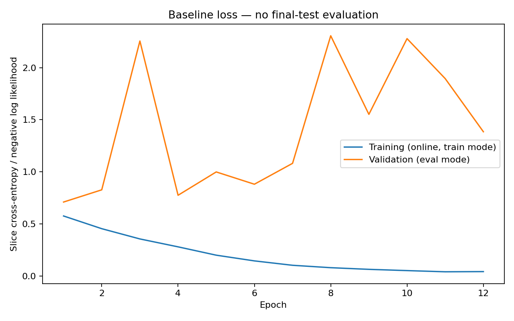
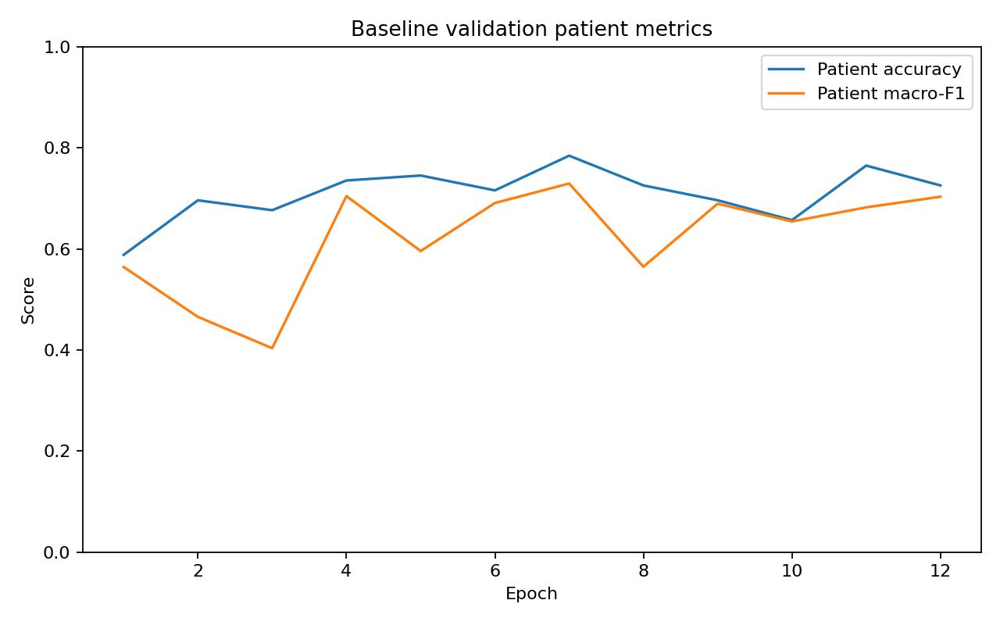

# Pattern Analysis
Pattern Analysis of various datasets by COMP3710 students in 2025 at the University of Queensland.

We create pattern recognition and image processing library for Tensorflow (TF), PyTorch or JAX.

This library is created and maintained by The University of Queensland [COMP3710](https://my.uq.edu.au/programs-courses/course.html?course_code=comp3710) students.

The library includes the following implemented in Tensorflow:
* fractals 
* recognition problems

In the recognition folder, you will find many recognition problems solved including:
* segmentation
* classification
* graph neural networks
* StyleGAN
* Stable diffusion
* transformers
etc.

<!-- COMP3710-STEP6-DATA-PIPELINE -->
## Data pipeline

The finalized patient-independent manifests, rather than the original directory names, determine the training, validation and test partitions. The CSV hashes and grouping consistency were verified before loading images. Model labels are NC = 0 and AD = 1; the original metadata codes 0 and 2 are retained as provenance.

| Partition | Patients | Scans | Images |
|---|---:|---:|---:|
| train | 476 | 1061 | 21220 |
| validation | 102 | 233 | 4660 |
| test | 102 | 232 | 4640 |

### Preprocessing and checks

Each supplied 256-by-240 greyscale JPEG is resized to 224-by-210 using bilinear interpolation and padded with seven black pixels above and below. No anatomy is cropped and the original aspect ratio is preserved. The result is one channel of 224-by-224 float32 values, scaled using (pixel / 255 - 0.5) / 0.5. This fixed scaling does not fit statistics to validation or test images. It does not recover physical MRI intensities from the supplied JPEGs.

The initial configuration uses no random augmentation. A small training-only rotation is implemented but disabled; enabling it later is a separate, documented experiment. Both the CNN baseline and ConvNeXt will use the same selected preprocessing.

A CPU-only pass successfully checked every final training and validation sample for shape, dtype, finite/range-correct values and exactly-once coverage, including the last partial batch. It did not train a network or decode the held-out test images. The test manifest was read only for split-integrity verification.

Subject and scan identifiers are retained privately in each batch for later hierarchical aggregation of probabilities; slice counts must not be confused with independent patient counts. Patient-level evaluation and confidence-based referral will be implemented with the training/evaluation stages.

A private before/after preview was generated for separate visual inspection. A local-byte versus Rangpur-source hash comparison was not performed. Model training, GPU memory and runtime measurements remain outstanding.

### Artificial Intelligence Usage Disclosure — update

ChatGPT assisted with drafting the data loader, verification script and synthetic tests. The code was checked by automated synthetic tests and a local CPU loader pass. I will document my own code review, understanding, visual inspection and any changes; these are not implied by the automated pass.

Manual visual check (2026-10-22): I inspected the private before/after training preview and found no unintended orientation, cropping or stretching changes.

<!-- COMP3710-STEP7-BASELINE -->
## Initial CNN baseline experiment

A four-block convolutional classifier was trained from scratch as the simpler comparison for the forthcoming ConvNeXt model. It uses the unchanged one-channel, 224-by-224 data pipeline. The fixed model labels are NC = 0 and AD = 1.

### Predeclared training and model selection

Configuration: `{'batch_size': 32, 'epochs': 20, 'patience': 5, 'learning_rate': 0.001, 'weight_decay': 0.0001, 'seed': 42, 'num_workers': 0, 'gradient_clip_norm': 5.0, 'device': 'cuda'}`. Training uses ordinary unweighted slice-level cross-entropy and uniformly shuffled images; repeated scans therefore contribute more training examples. No class weighting, data augmentation, pretrained weights, learning-rate search, calibration or threshold tuning was used in this initial experiment.

Validation aggregation averages slice probabilities within each scan, then averages the scan probabilities within each patient. The probability threshold is 0.5. Checkpoint selection uses patient macro-F1, with lower patient log loss breaking exact ties; the earliest exact tie is retained. Early stopping uses the same rule. These validation results are selected development results, not an unbiased final-test estimate.

Completed epochs: **12**; selected epoch: **7**.

| Validation unit | N | Accuracy | Macro-F1 | AUROC |
|---|---:|---:|---:|---:|
| slice | 4660 | 0.6910 | 0.6747 | 0.7790 |
| scan | 233 | 0.7082 | 0.6867 | 0.8236 |
| patient | 102 | 0.7843 | 0.7292 | 0.8327 |

Patient AD recall: **0.5152**. Patient NC recall: **0.9130**.
Training-majority-class reference validation accuracy: **0.6765**.

### Resources and reproducibility

Learnable parameters: **359,922**. Hardware: `{'torch_version': '2.7.1+cu126', 'device': 'cuda', 'precision': 'float32; mixed precision and TF32 disabled', 'device_name': 'NVIDIA GeForce RTX 4080 Laptop GPU', 'total_device_memory_gib': 11.99365234375}`.
Training-loop wall time (all completed epochs, including validation/checkpoints/history): **555.47 seconds**.
GPU allocator peaks: `{'peak_allocated_gib': 0.1967020034790039, 'peak_reserved_gib': 0.29296875, 'note': 'PyTorch process allocator peaks, not total VRAM used by Windows/other processes.'}`.
Model-only batch-size-1 latency: `{'batch_size': 1, 'repeats': 50, 'warmup': 10, 'median_ms_per_slice': 0.8040000102482736, 'p95_ms_per_slice': 0.8248999947682023, 'scope': 'Forward pass only, tensor already on device; not patient/end-to-end latency.'}`. This excludes image decoding/preprocessing and is not a full-patient latency.

CSV hashes, source-code hashes, the exact configuration, per-epoch history and the selected checkpoint were retained. Checkpoints and patient-linked prediction files are private and are not committed to GitHub. The final test images have not been evaluated by this step.

### Limitations and next experiment

This is one initial seed/configuration. The small training-subset fitting check is a debugging test, not evidence of generalisation. Validation performance may be optimistic because it selected the checkpoint. The test comparison, confidence-based referral, failure analysis and comparison with ConvNeXt remain outstanding.

### AI assistance for this stage

ChatGPT assisted with the baseline architecture, training/evaluation code, synthetic tests and this report draft. The student must document the checks they personally performed and must not treat generated code or test results as a substitute for understanding the model.

