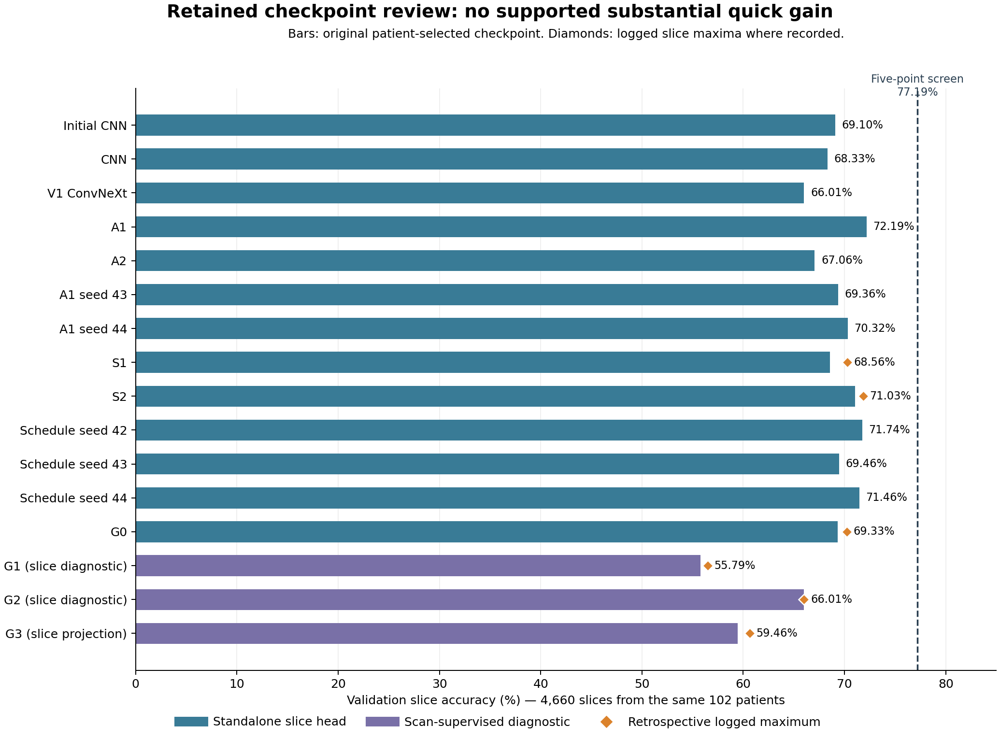
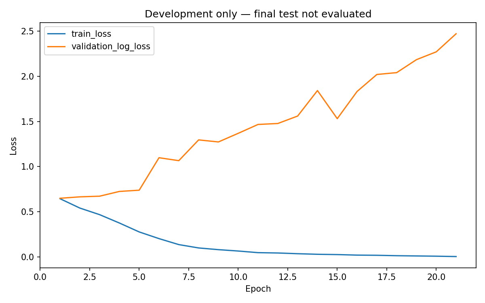
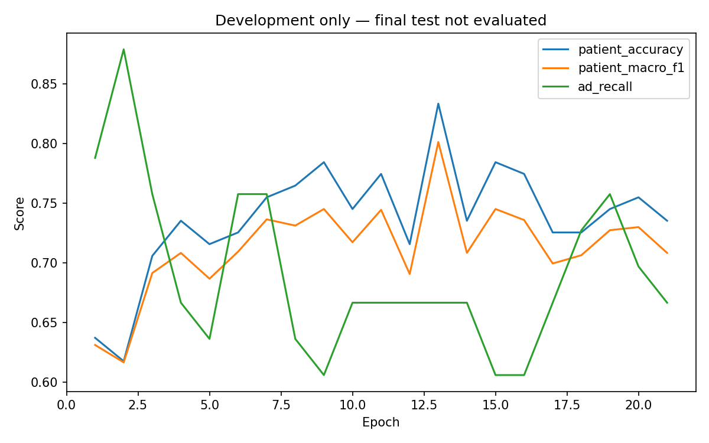
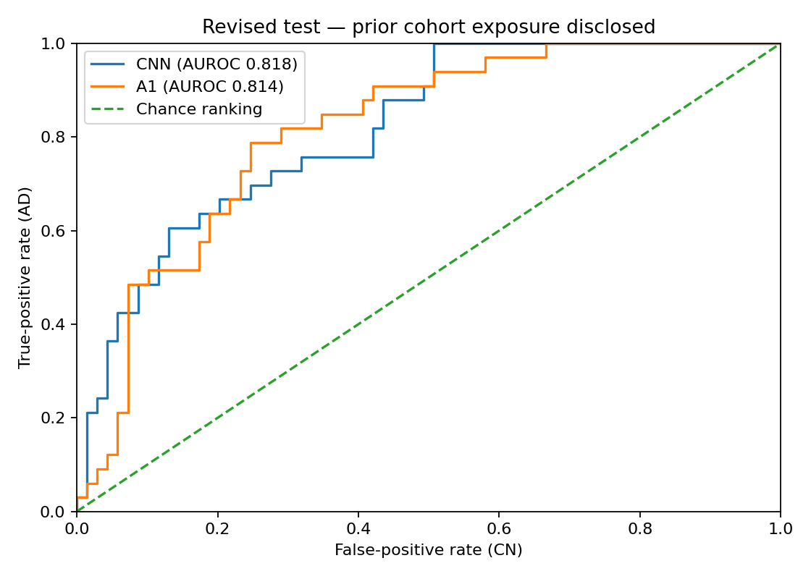
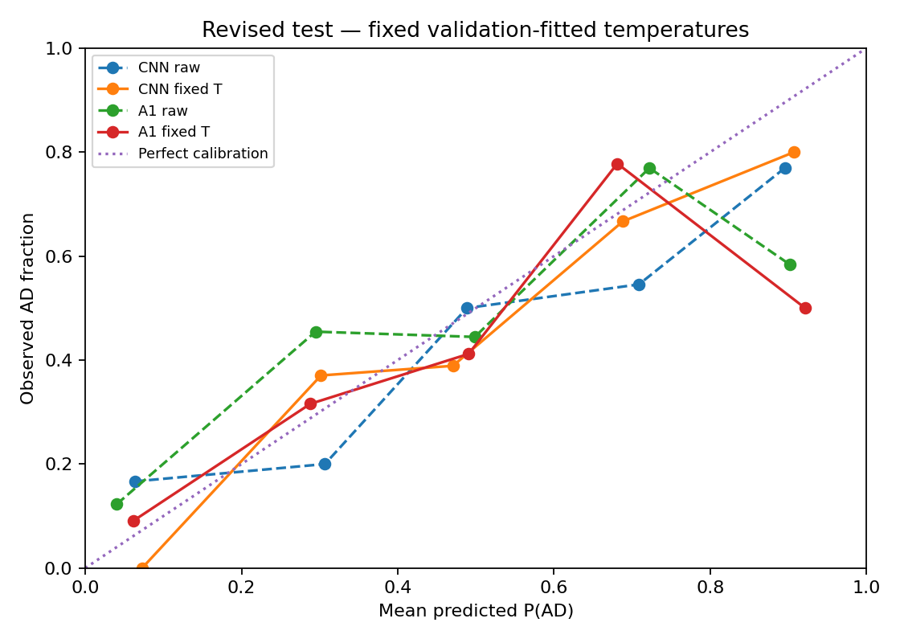

# Alzheimer's classification with ConvNeXt: accuracy, confidence and referral trade-offs

**COMP3710 — Semester 2, 2026**  
**Author:** Angus Walker  
**Student identifier supplied:** s4963173  
**Status (29 October 2026):** A1 retained; schedule-only, G012 and G3 studies remain negative under their original patient-based screens. **Primary test-slice accuracy: 3,157/4,640 = 68.04%, below 80%.** The saved-evidence review supports no substantial quick checkpoint change. Submission interfaces retain the completed clean-code verification in the pinned environment; full-mark readiness is not claimed.

## 1. Problem, intended user and principal finding

This project investigates a research-only assistant that classifies structural brain MRI images from the supplied ADNI data as Alzheimer's disease (AD) or cognitively normal (CN), and refers uncertain predictions for human review. The supplied folders use `NC`; the code maps this to the control class described as CN in the assessment. Neither class predictions nor confidence scores constitute clinical diagnoses.

The main question is whether a scratch-trained ConvNeXt improves image classification and confidence-based referral enough to justify its computational cost compared with a small CNN. Historical development prioritised patient-aggregate selection and referral; the user-supplied Ed clarification now establishes individual 2D test slices as the assessment accuracy unit. The selected model is ConvNeXt A1 (`scratch_augmented`, seed 42, selected epoch 13). The baseline is the regularized CNN selected at epoch 14.

The retained A1 checkpoint was originally selected using patient-level validation metrics. Following the **user-supplied Ed clarification** that the assessed prediction is an individual 2D slice, the primary reported test accuracy is **3,157/4,640 (68.04%)**, below the specified **0.80** target. The CNN records **3,193/4,640 (68.81%)** on the same slices. A1 is 555 correct slices short of 3,712 required for 80%. These results were already saved in the retained evaluation; the correction is reporting alignment, not new inference.

The **85/102 (83.33%) validation-patient** and **76/102 (74.51%) test-patient** accuracies use explicit probability aggregation and remain additional engineering analyses. CNN test-patient accuracy is 79/102 (77.45%). Calibration and referral findings below concern patients, not calibrated slices. They do not remedy the primary image-accuracy shortfall. No author/date/permalink or marking consequence is invented for the supplied clarification.

**Evaluation qualification:** the same patient-independent test cohort had already been evaluated for Version 1. Subsequent development used training and repeatedly consulted validation data; the revised checkpoint, temperatures and policies were fixed before revised inference. This is not a new untouched independent test. Prior test exposure, validation reuse and limited patient numbers constrain the conclusions.

## 2. Feasibility review and changes from the proposal

Retained project records report approval of the feasibility review and the corrected patient-independent split. This is an attributed project record, not independent confirmation of the compulsory consultation hurdle. The exact consultation date, verbatim feedback and final hurdle status require author confirmation. Appendix A preserves the original proposal as historical material, rather than retrospectively describing it as a completed experiment.

The project moved from Rangpur execution to a local NVIDIA RTX 4080 Laptop GPU. Dataset access, patient mapping, model training and resource measurements were subsequently checked. The supplied train/test directory split was replaced after the metadata audit identified 216 shared patient identifiers; the corrected patient grouping and split change were approved as reported by the author. All original files were retained, with manifests defining the new partitions.

The proposed 12 GiB memory limit and 12 GPU-hour initial-experiment budget were planning constraints, not total measured project cost. Training includes an interrupted original attempt; per-run recorded times do not necessarily include discarded partial epochs or downtime. Measured resource scopes are distinguished below.

## 3. Data integrity and experimental partitions

The local dataset contains 30,520 JPEG slices from 1,526 scans and 680 distinct mapped patients. The exact JPEG-prefix-to-metadata-key join links scans to records; the prefix itself is not the patient identifier. Participant tokens were checked for agreement across the seven metadata path fields. Metadata codes 0 and 2 map to model labels NC=0 and AD=1. The audit found no unreadable images or exact duplicate encoded/decoded images in the inspected copy. This does not rule out all forms of dataset bias or near-duplication.

The corrected split groups all scans and slices of a patient together. Within each class, a deterministic SHA-256 ordering using seed 42 and largest-remainder allocation implements the declared approximate 70/15/15 patient proportions. The proportions of scans and slices need not match these patient proportions.

| Partition | Patients (CN / AD) | Scans | Slices |
|---|---:|---:|---:|
| Training | 476 (321 / 155) | 1,061 | 21,220 |
| Validation | 102 (69 / 33) | 233 | 4,660 |
| Test | 102 (69 / 33) | 232 | 4,640 |

All three patient sets are disjoint. Manifest hashes and image hashes were recorded. Later image-integrity checks compare against the local audit, not against an independently hashed Rangpur source. Multiple slices from one patient are correlated and must not be counted as independent patients.

### Input preparation

Each 256 x 240 greyscale JPEG is resized to 224 x 210 using bilinear interpolation. Seven black pixels are added above and below to produce a one-channel 224 x 224 tensor without stretching the original aspect ratio. Values are converted to float32 and scaled by `(pixel / 255 - 0.5) / 0.5`; this does not recover physical MRI intensities from JPEG data and does not fit dataset-wide statistics.

A1 uses training-only rotations sampled between -5 and +5 degrees. Validation and test inputs have no random augmentation. Rotation can clip peripheral content; a private preview was produced for inspection. No patient, scan or slice was discarded on the basis of the diagnostic results. Final partitions are read from manifests, not inferred from the old directory names.

## 4. Models and working principles

### ConvNeXt-Tiny

ConvNeXt-Tiny follows the architectural family described by Liu et al. [2], adapted to one input channel and two output classes. It was implemented using PyTorch and trained from random initial weights; external pretrained weights were not used in the reported experiments.

| Stage | Operation / blocks | Channels | Spatial size |
|---|---|---:|---:|
| Input | Preprocessed greyscale MRI slice | 1 | 224 x 224 |
| Stem | 4 x 4 convolution, stride 4, channel normalization | 96 | 56 x 56 |
| Stage 1 | 3 ConvNeXt blocks | 96 | 56 x 56 |
| Stage 2 | Downsample, then 3 blocks | 192 | 28 x 28 |
| Stage 3 | Downsample, then 9 blocks | 384 | 14 x 14 |
| Stage 4 | Downsample, then 3 blocks | 768 | 7 x 7 |
| Output | Spatial mean, LayerNorm, two-logit linear head | 2 | One output pair |

Each block applies a 7 x 7 depthwise convolution, channel LayerNorm, a fourfold-expanded linear bottleneck, GELU, a projection, LayerScale and a residual connection with stochastic depth during training. The two logits correspond to NC and AD; a softmax supplies the slice AD score. The model has 27,818,594 trainable parameters. Large capacity alone does not guarantee generalisation from a limited patient cohort.

### CNN baseline

The baseline contains four stride-2 Conv/BatchNorm/ReLU blocks with channels 16, 32, 64 and 128. A fixed spatial pooling layer, a 128-unit dense layer, ReLU and dropout precede the two-class head. Its 359,922 trainable parameters provide a substantially smaller comparison. Input preparation, partitions and evaluation definitions match those used for the main model, while architecture and intrinsic regularization differ.

### Aggregation and evaluation units

Slice probabilities are averaged within each scan; scan probabilities are then averaged within each patient. This gives each scan equal weight within its patient. Classification is AD for probability >=0.5, otherwise CN. Individual slice test accuracy is primary for assessment. Scan/patient performance uses these explicit additional aggregation rules and is secondary. Patient disjointness is the split constraint at every scoring unit. Single-slice cross-entropy training and hierarchical probability aggregation are not the same objective. In A1, patients with more scans contribute more training examples.

## 5. Development experiments and selection

Training used hard-label unweighted cross-entropy without label smoothing for A1, AdamW, float32, global gradient clipping at norm 5 and the recorded deterministic/recovery settings. A1 used batch size 8 with four-batch accumulation, peak learning rate 0.0003, three warmup epochs, cosine decay to 0.000001 at the original epoch-30 endpoint, weight decay 0.05 for matrix/kernel parameters and no decay for biases/one-dimensional parameters. The limit was 30 epochs, with patience 8 after at least 12 epochs. Workers were zero in the checked Windows recovery path.

The following are historical project decisions, not course-mandated selection criteria. Version 1 selected checkpoints by validation patient macro-F1, then lower patient log loss. V2 explicitly changed to patient accuracy, then macro-F1, then lower log loss, retaining the earliest exact tie. This is a documented change, not retrospective relabelling of the first experiments.

| Development experiment | Selected epoch | Validation patient accuracy | Validation patient macro-F1 | Validation patient AUROC | Validation patient AD recall |
|---|---:|---:|---:|---:|---:|
| Initial CNN | 7 | 78.43% | 0.7292 | 0.8327 | 51.52% |
| Regularized CNN | 14 | 78.43% | 0.7496 | 0.8037 | 63.64% |
| Original ConvNeXt | 11 | 76.47% | 0.7167 | 0.8006 | 54.55% |
| **A1: rotations, seed 42** | **13** | **83.33%** | **0.8012** | **0.8331** | **66.67%** |
| A2: additional patient weighting | 12 | 80.39% | 0.7683 | 0.7874 | 63.64% |
| A1 replication, seed 43 | 8 | 78.43% | 0.7496 | 0.7980 | 63.64% |
| A1 replication, seed 44 | 7 | 78.43% | 0.7574 | 0.8169 | 69.70% |
| S1: label smoothing | 9 | 78.43% | 0.7403 | 0.7848 | 57.58% |
| S2: smoothing and revised schedule | 9 | 78.43% | 0.7496 | 0.8292 | 63.64% |

All rows use the same validation patients and are selected development scores. They are not independent test estimates. A1 exceeded 80% patient-validation accuracy in one selected epoch, but this is not the image-based course target; its two replications did not reproduce that patient result. The three-run mean does not represent an ensemble or three independent patient cohorts. Eleven validation patients were misclassified by all three A1 seeds, including nine AD patients. This finding does not establish the cause or justify removing these patients.

Near-perfect later training slice accuracy and increasing validation slice log loss are consistent with overfitting. Most A1/V2 histories do not record per-epoch slice-validation accuracy, so a measured per-epoch training/validation accuracy gap must not be inferred from their loss columns. A2's equal-patient weighting did not improve the comparison. S1 and S2 reduced some highly confident errors, and S2 improved patient log loss, but neither matched A1's classification result. These negative findings are retained. Changes from Version 1 to V2 include more than augmentation, so the improvement is not attributed causally to augmentation alone.

A1 remained selected based on development evidence. No new model, ensemble or classification cutoff was chosen using the revised test outcomes.

### Later controlled schedule experiment

After a scoped source/evidence review, one predeclared experiment changed only the A1 cosine endpoint from epoch 30 to 12. It retained hard labels, unweighted loss, the 3e-4 peak, 1e-6 floor, three warmup epochs, rotations, batch/accumulation, optimizer grouping, clipping, precision and selection rule. The peak remained at epoch 4; the floor was reached at epoch 12 and then held. The experiment plan and code were committed before training.

| Seed | Selected / completed epoch | Validation patients correct / 102 | Validation AD patients detected / 33 | Validation patient accuracy | Validation patient NLL | Paired correct-patient change |
|---|---:|---:|---:|---:|---:|---:|
| 42 | 7 / 15 | 81 | 19 | 79.41% | 0.505059 | -4 |
| 43 | 5 / 13 | 76 | 17 | 74.51% | 0.495243 | -4 |
| 44 | 9 / 17 | 81 | 24 | 79.41% | 0.521898 | +1 |

All three completed by the original eight-epoch patience rule. Their first four epochs matched each seed's control on all declared scalar measurements exactly (loss tolerance 1e-6, scores/recalls 1e-12, updates exact). Full validation replay of every selected checkpoint also matched exactly under the 2e-5 probability tolerance with unchanged classes. Seed 43 recovered the same attempt after an atomic-file error and two disk-guard stops; all execution, including discarded partial work, remained charged. No replacement attempt was created.

The predeclared screen failed: summed correct was 238 rather than at least 251; only one seed improved; two lost four patients. Mean AD recall fell from 66.67% to 60.61%, and seed 42 failed the 85-correct/22-AD guard. Mean ordinary patient NLL improved from the exact control mean 0.542208826357733 to 0.5074003661741057. The integrity/replay gate passed. Lower final-five-epoch variability did not provide repeatable recognition improvement. These are repeated development measurements on the same 102 patients, not 306 independent subjects.

**Decision:** record this as a negative experiment and retain A1, scratch_augmented, seed 42, epoch 13. No model promotion, calibration refit, threshold search or new test query followed. Detailed private histories, paired differences and fixed last-five summaries are retained under the separate schedule-only namespace; the public plan remains `SCHEDULE_ONLY_PLAN.md`.


### Later grouped-supervision and attention studies

G0 retained slice CE but changed grouping/update structure; G1 used negative log of the mean correct-class slice probability; G2 used CE of mean slice logits. G0 versus A1 therefore changes batching/update structure; G1 versus G0 isolates its scan loss under matched grouped training; G2 includes native logit-pooling inference. G3 used a fixed gated-attention 768→128→1 score on the original head inputs and weighted original slice logits. The verified historical G2 served as the fixed uniform control; no U3 or extra seed was run. All used scratch initialisation and the approved patient splits. See frozen [G012 plan](g012/G012_PLAN.md), [G3 plan](g3/G3_PLAN.md) and [control decision](g3/G3_CONTROL_COMPARABILITY.md).

| Run (seed 42) | Selected / completed epoch | Validation patients correct / 102 | Validation AD patients detected / 33 | Original patient screen | Selected validation slice-head correct / 4660 |
|---|---:|---:|---:|---|---:|
| G0 | 16 / 24 | 75 | 21 | Fail | 3231 |
| G1 | 7 / 15 | 69 | 0 | Fail | 2600 |
| G2 | 20 / 28 | 81 | 27 | Fail | 3076 |
| G3 | 14 / 22 | 73 | 24 | Fail | 2771 |

All completed normally by patience; original integrity/replay checks passed. The patient screen required at least 86 correct, at least 22 AD detections and macro-F1 at least exact A1 0.8012151782643586. Lower NLL was a reported trade-off, with deterioration over 0.02 a warning, not an extra gate. None was promoted. G3 attention learned nonuniform weights, but its selected patient accuracy, macro-F1, ranking and probability quality were worse than G2; this fixed one-seed negative does not refute attention generally. G1's smaller raw training loss is partly algebraic and is not evidence of better recognition.

G0/G1/G2 cumulative active charges including selected replay were 7,026.501 / 3,399.968 / 8,178.031 seconds. G2 recovered the same attempt after a disk guard, with partial work retained in its charge. G3 charged 6,202.907 training + 19.844 replay = 6,222.751 seconds; its separately timed preparation/smoke were 3.814/8.026 seconds. G3 committed epoch-loop time was 6,166.810 seconds and peak training allocated GPU memory 2.5497 GiB (G2 2.5467 GiB). Fewer completed epochs, different timing scopes and interruptions prevent a claim that G3 was intrinsically faster. These scopes are not the original A1 component timing in Section 8.

### Retrospective slice-alignment review and stopping decision

The finite saved-evidence review found no available checkpoint supporting at least a five-percentage-point slice-validation improvement over A1 without lower slice macro-F1 or AD recall. The threshold (3,597/4,660) was a time-prioritisation screen, not a course rule. No candidate was promoted, inferred or replayed. A1 is the highest observed slice accuracy among the historically selected checkpoints in this inventory, not a proven best epoch from missing metrics or the best possible classifier.

| Run / seed | Selected / completed epoch | Validation slices correct / N | Validation slice accuracy | AD precision / recall | CN precision / recall | Slice macro-F1 | Slice AUROC | Slice NLL | Slice Brier |
| --- | --- | --- | --- | --- | --- | --- | --- | --- | --- |
| Initial CNN / 42 | 7 / 12 | 3220 / 4660 | 69.10% | 69.92% / 52.82% | 68.69% / 82.00% | 0.674658 | 0.778987 | 1.081850 | 0.253251 |
| CNN / 42 | 14 / 22 | 3184 / 4660 | 68.33% | 66.67% / 56.70% | 69.33% / 77.54% | 0.672414 | 0.744020 | 2.023849 | 0.287649 |
| V1 ConvNeXt / 42 | 11 / 19 | 3076 / 4660 | 66.01% | 62.93% / 56.21% | 68.01% / 73.77% | 0.650798 | 0.720507 | 2.245499 | 0.310535 |
| A1 / 42 | 13 / 21 | 3364 / 4660 | 72.19% | 71.44% / 61.80% | 72.65% / 80.42% | 0.713046 | 0.788117 | 1.559219 | 0.248017 |
| A2 / 42 | 12 / 20 | 3125 / 4660 | 67.06% | 65.16% / 54.76% | 68.18% / 76.81% | 0.658733 | 0.727529 | 1.555233 | 0.284952 |
| A1 seed 43 / 43 | 8 / 16 | 3232 / 4660 | 69.36% | 67.27% / 59.76% | 70.71% / 76.96% | 0.684961 | 0.757438 | 1.283005 | 0.262683 |
| A1 seed 44 / 44 | 7 / 15 | 3277 / 4660 | 70.32% | 67.40% / 63.64% | 72.41% / 75.62% | 0.697237 | 0.773052 | 0.982948 | 0.238141 |
| S1 / 42 | 9 / 17 | 3195 / 4660 | 68.56% | 67.15% / 56.55% | 69.40% / 78.08% | 0.674404 | 0.737702 | 0.770366 | 0.247006 |
| S2 / 42 | 9 / 17 | 3310 / 4660 | 71.03% | 68.32% / 64.27% | 72.96% / 76.38% | 0.704334 | 0.758241 | 0.722501 | 0.226722 |
| Schedule seed 42 / 42 | 7 / 15 | 3343 / 4660 | 71.74% | 72.61% / 57.91% | 71.26% / 82.69% | 0.704938 | 0.784579 | 1.159064 | 0.240361 |
| Schedule seed 43 / 43 | 5 / 13 | 3237 / 4660 | 69.46% | 67.41% / 59.85% | 70.79% / 77.08% | 0.686041 | 0.765954 | 0.748905 | 0.224151 |
| Schedule seed 44 / 44 | 9 / 17 | 3330 / 4660 | 71.46% | 67.27% / 69.03% | 74.94% / 73.38% | 0.711454 | 0.794759 | 1.366919 | 0.245013 |
| G0 / 42 | 16 / 24 | 3231 / 4660 | 69.33% | 65.89% / 63.50% | 71.89% / 73.96% | 0.687912 | 0.746815 | 0.708483 | 0.226408 |
| G1 / 42 | 7 / 15 | 2600 / 4660 | 55.79% | 0.00% / 0.00% | 55.79% / 100.00% | 0.358127 | 0.571028 | 0.684136 | 0.245525 |
| G2 / 42 | 20 / 28 | 3076 / 4660 | 66.01% | 59.02% / 75.58% | 75.12% / 58.42% | 0.660063 | 0.697176 | 1.618217 | 0.327343 |
| G3 / 42 | 14 / 22 | 2771 / 4660 | 59.46% | 52.41% / 90.24% | 81.94% / 35.08% | 0.577173 | 0.642805 | 1.079570 | 0.339880 |


All sixteen rows use identical approved validation membership. G1/G2 raw head scores are scan-supervised slice diagnostics; G3 projections are not its native attention-bag prediction. Pooled probabilities were not replicated across slices. Lower raw slice NLL/Brier for smoothing or some schedule variants does not satisfy the substantial classification gain screen.

Per-epoch validation slice accuracy is absent from V1/CNN and A1/V2/stability/schedule histories; train_slice_accuracy and validation loss are not substitutes. Logged maxima: S1 epoch 14 3275/4660; S2 epoch 13 3348/4660; G0 epoch 14 3273/4660; G1 epoch 14 2633/4660; G2 epoch 20 3076/4660; G3 epoch 16 2825/4660. Only G2's maximum is selected/fully cached; G1 epoch 14 survives in its previous state but lacks the full slice metric set. The other four maximum-epoch weights are not retained in those runs. Every logged maximum is below A1 anyway. Final/current/previous states without metrics are not newly scored or mislabelled as best-slice checkpoints.

Full provenance, original selection rules, retained epoch inventory, complete aggregate class/probability metrics and limitations are in [SLICE_ALIGNMENT_REVIEW.md](SLICE_ALIGNMENT_REVIEW.md), [CSV](slice_alignment_metrics.csv) and [JSON](slice_alignment_metrics.json). Original patient screens remain historical results; this retrospective review does not replace them with a prospective slice experiment.







These are the unchanged curves saved during A1 development. Their original “final test not evaluated” title describes the state when they were generated; the later disclosed test exposure is reported in Section 7.

## 6. Confidence, calibration and referral — secondary patient analyses

Temperature scaling [3] was fitted to aggregated patient log odds using validation data. Its scalar temperature preserves the class decision at 0.5 while changing confidence. The fitted temperatures are approximately 1.61343 for the CNN and 1.85536 for A1. Five-fold cross-fitting was used as a development diagnostic: it held each fold out of calibration/rule fitting, but did not undo earlier checkpoint selection on the complete validation cohort.

The reference rule accepts a prediction only at sufficient calibrated confidence, otherwise referring it. The thresholds are 0.85 for the CNN and 0.75 for A1. They were chosen on a finite development grid subject to the declared empirical coverage/error constraints; those constraints are not clinical standards. The reference procedure was unstable across development folds.

Two additional policies were declared before their comparison: `strict_cn` adds calibrated P(AD)<=0.05 to any automatic CN proposal, and `no_auto_cn` sends every CN proposal to review. AD flags are unchanged. All three are reported; there is no test-based selection of a winning policy. An AD flag is not a confirmed diagnosis, and a referral is not a correct diagnosis.

### Development confidence evidence — patient unit

| Model | Raw NLL | Cross-fit NLL | Raw Brier | Cross-fit Brier | Raw errors at confidence >=0.90 | Full-fit cutoff | Cross-fit accepted / errors |
|---|---:|---:|---:|---:|---:|---:|---:|
| CNN | 0.5205 | 0.5012 | 0.1715 | 0.1692 | 4 | 0.85 | 27 / 4 |
| A1 | 0.5141 | 0.5042 | 0.1421 | 0.1519 | 4 | 0.75 | 20 / 4 |

A1's full-validation fitted rule accepts 48/102 with 4/48 errors, but its cross-fit diagnostic accepts 20/102 with 4/20 errors. The CNN cross-fit accepts 27/102 with 4/27 errors. Thus the apparent full-fit advantage does not establish robust operational superiority. Cross-fitting separates calibration/referral fitting from held-out folds only; earlier model selection already consulted all validation patients. Temperature scaling cannot improve the fixed 0.5 classification decisions or create discriminative information.

The strict-CN and no-auto-CN policies are reported with their correct denominators. Automatically clearing no CN predictions removes automated negative errors by construction; it is not 100% diagnostic sensitivity or proof of safety. Specialist review outcomes and real operational workload have not been measured.


## 7. Disclosed revised evaluation — primary slice assessment result

The original ConvNeXt achieved 72.55% on the Version 1 patient test. A1's later evaluation reused that patient-independent cohort after development using training/validation evidence. The checkpoint, preprocessing, temperatures and all policies were recorded before revised inference. This process limits additional test-based selection but cannot erase prior exposure or adaptive-development bias.

### Individual 2D test slices (primary)

| Model | Test slices correct / N | Test slice accuracy | AD precision / recall | CN precision / recall | Slice macro-F1 | Slice AUROC | Raw slice NLL | Raw slice Brier | TN / FP / FN / TP |
| --- | --- | --- | --- | --- | --- | --- | --- | --- | --- |
| A1 (epoch 13) | 3157/4640 | 68.04% | 78.72% / 54.43% | 61.86% / 83.39% | 0.676945 | 0.779813 | 1.928413 | not recorded | 1818 / 362 / 1121 / 1339 |
| Regularized CNN (epoch 14) | 3193/4640 | 68.81% | 76.81% / 58.98% | 63.32% / 79.91% | 0.686915 | 0.776140 | 2.019384 | not recorded | 1742 / 438 / 1009 / 1451 |


True rows/predicted columns are CN then AD. A1 matrix is `[[1818,362],[1121,1339]]`; CNN matrix is `[[1742,438],[1009,1451]]`. The slice results and AUROC/NLL come from the existing revised aggregate summary; integer arithmetic confirms counts and per-class metrics. Raw test-slice Brier was not recorded there and was not reconstructed from private test predictions. A1 has 1,121 AD slice false negatives versus CNN 1,009, and 362 CN slice false positives versus CNN 438. A1's net 36 fewer correct slices coexists with slightly higher AUROC and lower NLL; none attains 80% slice-test accuracy. No candidate choice uses these test comparisons.

### All-patient classification (secondary)

| Model | Test patients correct / N | Test patient accuracy | Patient macro-F1 | Patient AUROC | Patient AD recall | Patient CN recall |
|---|---:|---:|---:|---:|---:|---:|
| Regularized CNN (epoch 14) | 79/102 | 77.45% | 0.7258 | 0.8177 | 54.55% | 88.41% |
| ConvNeXt A1 (seed 42, epoch 13) | 76/102 | 74.51% | 0.7040 | 0.8142 | 57.58% | 82.61% |

### Test-patient per-class precision and confusion counts

| Model | CN precision | AD precision | TN | FP | FN | TP |
|---|---:|---:|---:|---:|---:|---:|
| cnn | 0.8026 | 0.6923 | 61 | 8 | 15 | 18 |
| a1 | 0.8028 | 0.6129 | 57 | 12 | 14 | 19 |

### Other units and target reporting

| Model | Test patients correct / N (accuracy) | Test scans correct / N (accuracy) | Test slices correct / N (assessment accuracy) |
|---|---:|---:|---:|
| cnn | 79/102 (77.45%) | 168/232 (72.41%) | 3193/4640 (68.81%) |
| a1 | 76/102 (74.51%) | 158/232 (68.10%) | 3157/4640 (68.04%) |


cnn: descriptive Wilson 95% patient-accuracy interval 68.43%–84.48%.

a1: descriptive Wilson 95% patient-accuracy interval 65.27%–81.97%.

**Assessment target not met:** A1 test-slice accuracy is 68.04% against 80%, a shortfall of 555 correct slices. Patient-first was the historical project selection/evaluation choice; the supplied Ed clarification resolves assessment reporting to slices. The patient and scan results remain secondary and do not imply course-target attainment. Marks and any penalty/hurdle interpretation require teaching-team clarification; no waiver or deduction is assumed.

### All fixed patient policies: safety and workload

| Model | Policy | Auto CN | AD flagged | Refer | AD incorrectly auto CN / all AD | Accepted error | Clinical reviews* |
|---|---|---:|---:|---:|---:|---:|---:|
| cnn | reference | 28 | 4 | 70 | 0/33 | 3.12% | 74 |
| cnn | strict_cn | 15 | 4 | 83 | 0/33 | 5.26% | 87 |
| cnn | no_auto_cn | 0 | 4 | 98 | 0/33 | 25.00% | 102 |
| a1 | reference | 50 | 6 | 46 | 5/33 | 14.29% | 52 |
| a1 | strict_cn | 26 | 6 | 70 | 1/33 | 12.50% | 76 |
| a1 | no_auto_cn | 0 | 6 | 96 | 0/33 | 50.00% | 102 |

*Clinical reviews assume all AD flags also need confirmation; this workload is calculated, not observed. Referrals are not successful diagnoses. No-auto-CN removes automated negatives by construction. Accepted-subset accuracy does not replace all-patient accuracy. The 0.05 strict-CN cap is a fixed research choice, not a clinical safety bound. Descriptive policy confidence intervals and denominators are in the JSON.

### Patient probability quality

| Model | Raw NLL | Fixed-T NLL | Raw Brier | Fixed-T Brier |
|---|---:|---:|---:|---:|
| cnn | 0.5138 | 0.4839 | 0.1655 | 0.1607 |
| a1 | 0.6040 | 0.4979 | 0.1780 | 0.1661 |

Paired A1 minus CNN test-patient accuracy: -2.94 percentage points; exploratory patient-bootstrap interval -10.78% to 4.90%. This interval excludes training-seed/site uncertainty and the effects of previous test exposure.





## 8. Resource cost

| Model | Parameters | Inference peak allocated GiB | Prior batch-1 forward median ms | Completed revised test-batch seconds |
|---|---:|---:|---:|---:|
| cnn | 359,922 | 0.0461 | 1.062 | 14.943 |
| a1 | 27,818,594 | 0.2364 | 13.963 | 17.226 |

A1 has approximately 77 times as many parameters as the baseline. Batch-size-one forward latency is model-only timing with inputs already on the device; it excludes loading and patient aggregation. The inference allocator peaks above are not training-memory peaks or total Windows VRAM. The revised per-batch timings include integrity checks, decoding, preprocessing, transfer and forward conversion, but exclude setup, cache writes and recovery verification. These scopes must not be interchanged.

| Selected run | Recorded training time, seconds | Training peak allocated GiB | Timing scope |
|---|---:|---:|---|
| CNN | 1609.03 | 0.1170 | Wall time around the original training/validation loop, including its in-loop checkpoint/history I/O; excludes subsequent selected-checkpoint replay/profiling. |
| A1 | 6437.32 | 1.3108 | Excludes repeated work in interrupted epochs, setup/checkpoint I/O and downtime. |

## 9. Qualitative failure analyses

### Evidence scope and provenance

These analyses retain the reviewed private draft's case discussions, now checked against the revised A1 local records. The old and revised selections use different patients for F01, F04 and F05; F02 and F03 retain the patient alias correspondence but the run/model outputs still differ. The older worksheet is therefore not the source for revised outcomes.

For documentation verification, Codex matched the revised selection records to the already saved A1/CNN patient predictions, reconstructed the panel's documented scan/slice selection from cached records, and inspected the existing revised derived panels. Displayed slice indices and rounded probabilities agree in all five cases:

| Case | Revised displayed slice indices | Revised displayed slice P(AD) |
|---|---|---|
| F01 | 100, 105, 109 | 0.000, 0.000, 0.000 |
| F02 | 83, 88, 92 | 1.000, 0.999, 1.000 |
| F03 | 99, 104, 108 | 0.984, 0.999, 0.993 |
| F04 | 100, 105, 109 | 0.990, 0.001, 0.004 |
| F05 | 93, 98, 102 | 0.002, 0.000, 0.176 |

This resolves record/display correspondence; it is not an independent reconstruction of panel pixels from raw MRI data or a clinical interpretation. No raw test images were reopened and no test inference was run for this check. Current panel hashes and detailed correspondence evidence are retained privately. The author explicitly confirmed review of the revised cases during submission preparation; this is an author-reported review, distinct from Codex's record/display check. Public redistribution permission for the medical panels is not established, so no panels, source paths or participant identifiers are included in the repository. These cases inform documentation of the frozen result, not model or policy changes.

These are five patient-level autopsies, not five independently sampled image-error evaluations. In the already reviewed displayed outputs, F01/F05 slices are CN predictions against AD labels; F02/F03 slices are AD predictions against CN labels. F04 has one AD and two CN displayed predictions against a CN label: its patient false positive does not make all displayed slices wrong. This is a documentation clarification of the retained reviewed records, not newly opened test-case analysis.

The panels show three representative inputs with rounded slice-level AD scores. Patient probabilities in the tables are aggregates of all recorded slices and scans and need not equal the mean of the three displayed scores. The images are not saliency maps, clinical diagnoses or causal explanations. Values shown as 0.000 or 1.000 are rounded displays, not demonstrations of certainty.

Actions: `auto_CN` means an automatic CN proposal; `AD_flag` means an AD alert needing confirmation; `refer` means unresolved human review. The dataset uses NC for the class described here as CN. All numerical table entries below are preserved from the supplied revised table. Medical images and original participant identifiers are excluded from this report-input document.


### F01

| Model | Dataset class | Prediction | Raw P(AD) | Calibrated P(AD) | Reference | Strict CN | No auto CN |
|---|---|---|---:|---:|---|---|---|
| cnn | AD | CN | 0.1231 | 0.2284 | refer | refer | refer |
| a1 | AD | CN | 0.0019 | 0.0331 | auto_CN | auto_CN | refer |

**Observed image/data properties:** The supplied panel shows three side-on brain views with visible tissue boundaries against a black background. No missing image or grossly blank input is apparent at this display resolution. All three displayed slice AD scores round to 0.000; these are rounded slice outputs, not proof of exactly zero disease probability. The revised case table records an AD-labelled patient with A1 raw P(AD)=0.0019 and calibrated P(AD)=0.0331, establishing a strongly confident false negative against the dataset label.

**Possible explanation and uncertainty:** Agreement among these three displayed slices does not establish correctness. The case is consistent with a learned representation that fails to distinguish this patient's labelled class, but the panel cannot identify the features responsible. Insufficient diagnostic information in the sampled slices, unmodelled variation and a mismatch between slice supervision and patient diagnosis are hypotheses, not demonstrated causes. Neither early disease nor a specific anatomical abnormality can be inferred from these images alone.

**CNN comparison and policy consequences:** Both models classify the patient as CN. However, the CNN's calibrated P(AD)=0.2284 leads to referral under all three policies. A1's calibrated score corresponds to CN confidence of 0.9669: its incorrect CN proposal survives both the reference policy and the stricter P(AD)<=0.05 rule. Only the no-automatic-CN policy refers this A1 result. Thus, the additional negative-confidence requirement fails to protect this particular patient.

**Recommended limitation or safeguard:** Do not interpret a high-confidence CN prediction as clinical clearance. This case supports mandatory clinical review rather than autonomous reassurance. Investigating the full available scan context and input characteristics could be useful in future independent work, but the cause must remain unresolved here and this case must not be used to tune the already evaluated model.

### F02

| Model | Dataset class | Prediction | Raw P(AD) | Calibrated P(AD) | Reference | Strict CN | No auto CN |
|---|---|---|---:|---:|---|---|---|
| cnn | CN | AD | 0.9975 | 0.9760 | AD_flag | AD_flag | AD_flag |
| a1 | CN | AD | 0.9962 | 0.9525 | AD_flag | AD_flag | AD_flag |

**Observed image/data properties:** The three supplied views retain visible brain contours and internal tissue boundaries, with the central dark region changing shape across slice positions. The displayed AD scores are 1.000, 0.999 and 1.000, rounded to three decimal places. In the revised case table the dataset class is CN, while A1 has raw P(AD)=0.9962 and calibrated P(AD)=0.9525. The displayed evidence therefore accompanies a highly confident false positive; confidence does not override the recorded class.

**Possible explanation and uncertainty:** Both architectures may respond to shared image characteristics that resemble patterns learned from AD-labelled training examples, but this is only a possible explanation. Variation in anatomy, appearance or acquisition could contribute, yet none is established as the trigger. A visually prominent dark region cannot be called pathological enlargement or used to diagnose AD from these illustrative slices. Agreement between two models trained on the same data is not independent clinical confirmation.

**CNN comparison and policy consequences:** The CNN also produces a false positive, with raw P(AD)=0.9975 and calibrated P(AD)=0.9760. Every policy returns an AD flag for both models. This is expected because strict-CN and no-automatic-CN alter negative proposals only; they do not modify the positive side. Calibration softens the scores but does not change the classifications. The consequence is an unnecessary AD alert and confirmation workload, not an established clinical diagnosis.

**Recommended limitation or safeguard:** Present an AD flag as a request for specialist assessment, not a definitive diagnosis or a treatment decision. Keep this example in the false-positive analysis to show that false-negative safeguards do not address all harms. Future investigation could compare acquisition and appearance characteristics across independent cases, without assuming the dataset label is wrong or changing the current result.

### F03

| Model | Dataset class | Prediction | Raw P(AD) | Calibrated P(AD) | Reference | Strict CN | No auto CN |
|---|---|---|---:|---:|---|---|---|
| cnn | CN | CN | 0.3308 | 0.3925 | refer | refer | refer |
| a1 | CN | AD | 0.9532 | 0.8353 | AD_flag | AD_flag | AD_flag |

**Observed image/data properties:** The supplied panel shows variation in the outlines and internal appearance across three slice positions, but all displayed AD scores are high: 0.984, 0.999 and 0.993. The revised case table identifies a CN-labelled patient. A1's patient-level raw P(AD)=0.9532 and calibrated P(AD)=0.8353 produce a false positive. These three selected slices illustrate consistent high-scoring outputs; they are not the complete set used to calculate the patient probability.

**Possible explanation and uncertainty:** The different model outcomes show that the larger architecture's learned decision function is not necessarily better for this individual. A1 may rely on image characteristics that the smaller CNN treats differently, but the panels do not reveal feature attribution or establish why. The CNN's correct classification should not be interpreted as proof that it recognised a particular clinical biomarker. No precise anatomical cause can be established from the available evidence.

**CNN comparison and policy consequences:** The CNN correctly predicts CN, with raw P(AD)=0.3308 and calibrated P(AD)=0.3925, but refers the patient because its confidence is insufficient for automatic acceptance. A1's calibrated AD score exceeds its 0.75 reference threshold and results in an AD flag under every policy. This contrasts a correct but cautious baseline prediction with an incorrect, more confident advanced-model prediction.

**Recommended limitation or safeguard:** Do not prefer a model merely because it is larger or more confident. The recorded disagreement is a useful failure-analysis signal and supports specialist confirmation of A1's flag. Using model disagreement as an additional referral mechanism would be a new policy requiring separate development and evaluation; it was not part of the frozen system assessed here.

### F04

| Model | Dataset class | Prediction | Raw P(AD) | Calibrated P(AD) | Reference | Strict CN | No auto CN |
|---|---|---|---:|---:|---|---|---|
| cnn | CN | CN | 0.3887 | 0.4303 | refer | refer | refer |
| a1 | CN | AD | 0.5295 | 0.5159 | refer | refer | refer |

**Observed image/data properties:** The supplied panel shows substantial score disagreement: the displayed slice AD scores are 0.990, 0.001 and 0.004. The middle image appears to have less distinct light-dark tissue contrast than the flanking views, but this display-level observation does not establish an acquisition defect. In the revised table this patient is CN-labelled, while A1's raw patient P(AD)=0.5295 and calibrated P(AD)=0.5159 give a borderline false positive.

**Possible explanation and uncertainty:** A near-boundary aggregate can coexist with highly confident but opposing slice predictions. Sensitivity to slice content or contrast is a plausible hypothesis, but the panel does not demonstrate causation. The three displayed probabilities must not be averaged to reconstruct the patient score: the implemented calculation uses all available slices within each scan and then averages the scan scores. The supplied images do not establish disagreement between different scans or identify a particular anatomical trigger.

**CNN comparison and policy consequences:** The CNN correctly predicts CN with raw P(AD)=0.3887 and calibrated P(AD)=0.4303. Both models refer the case under the reference, strict-CN and no-automatic-CN policies. The referral mechanism therefore prevents A1's borderline positive classification from becoming an accepted AD flag. It does not correct the classifier or supply a confirmed diagnosis; it transfers the unresolved decision to review.

**Recommended limitation or safeguard:** Retain explicit referral for low-confidence aggregates and document disagreement among available slice outputs where measured. No new scan-level model or disagreement policy was developed from this case. Do not drop the high-scoring slice or adjust the class threshold after inspecting this test case. The present evidence supports referral, not an anatomical diagnosis.

### F05

| Model | Dataset class | Prediction | Raw P(AD) | Calibrated P(AD) | Reference | Strict CN | No auto CN |
|---|---|---|---:|---:|---|---|---|
| cnn | AD | CN | 0.1964 | 0.2945 | refer | refer | refer |
| a1 | AD | CN | 0.0193 | 0.1073 | auto_CN | refer | refer |

**Observed image/data properties:** The three supplied views show visible brain tissue against a black background. Their displayed AD scores are 0.002, 0.000 and 0.176: they vary, but all remain below the 0.5 slice-classification boundary. The revised case table labels the patient AD. A1's raw patient P(AD)=0.0193 and calibrated P(AD)=0.1073 yield a false-negative CN prediction. The displayed zero is rounded, and the panel is not the complete patient input.

**Possible explanation and uncertainty:** Variation between the displayed slice outputs indicates sensitivity to slice content, but does not identify the responsible image feature. The patient-level aggregation remains on the CN side despite the higher score in the third view. Limited diagnostic information in individual slices or learned associations that fail for this case are possible explanations, not established findings. No disease stage, label error or causal anatomical abnormality is demonstrated by the panel.

**CNN comparison and policy consequences:** The CNN also predicts CN, with raw P(AD)=0.1964 and calibrated P(AD)=0.2945, but refers under every policy. A1's calibrated CN confidence is 0.8927, sufficient for its reference policy to accept the wrong CN proposal. Because its AD score 0.1073 exceeds the strict-CN maximum of 0.05, the stricter rule instead refers it; no-automatic-CN also refers it. Unlike F01, this is an example where stricter negative acceptance changes an unsafe automated proposal into review.

**Recommended limitation or safeguard:** Describe the improvement as prevention of one automated negative decision, not as successful AD diagnosis. The clinician's eventual result is unmeasured. This case illustrates a potential benefit of stricter referral, while F01 shows that the same safeguard can leave more confident errors untouched. The aggregate evaluation, rather than this selected success alone, must determine the overall safety-workload interpretation.

### Cross-case conclusion

These selected cases illustrate complementary failure modes. F01 and F05 are false negatives shared by both classifiers, but the CNN refers both whereas A1's reference policy accepts their CN proposals. The stricter CN rule redirects F05 but not the more confident F01, showing why increasing a confidence requirement does not guarantee removal of all dangerous errors. F02 is a shared high-confidence false positive; F03 is an A1 false positive that the CNN classifies correctly, although cautiously. F04 demonstrates that a borderline patient-level output can conceal strongly opposing slice scores, and that referral can prevent acceptance of an uncertain prediction without making the diagnosis correct.

Calibration changes the reported probabilities but does not change these class decisions at 0.5. Negative-side policies do not correct AD flags, and referrals are not counted as successful diagnoses. The panels contain no feature-attribution information and cannot establish the anatomical or acquisition cause of an error. These five deliberately selected examples describe mechanisms and operational consequences; they do not estimate population error rates. Their individual outcomes should be interpreted alongside the complete confusion matrices, calibration results and policy-workload measurements. The evidence supports human assessment rather than autonomous diagnosis or reassurance, with causal explanations left uncertain where they are not demonstrated.

## 10. Engineering recommendation and limitations

Under the tested conditions, A1 did not justify its additional model complexity for primary **test-slice** accuracy and macro-F1: 68.04% / 0.676945 versus CNN 68.81% / 0.686915, with the 0.80 slice-test target unmet. Its 72.19% selected slice-validation accuracy must not be confused with 83.33% validation-patient accuracy. The retrospective checkpoint inventory supports retaining A1 and closing model development under the remaining time budget, not speculative retraining or another experiment. It detected one more AD patient than the CNN but produced four more false positives. This small paired comparison does not establish that the CNN architecture is universally superior.

Fixed calibration improved A1's probability quality in the revised cohort without changing classifications. Stricter CN acceptance redirected four AD false negatives to review while also referring twenty additional CN patients; one AD patient still received automatic CN. The evidence does not support using this research prototype for autonomous diagnosis or negative clearance; its outputs should remain subject to clinical review. Referring everyone removes automatic negative decisions by definition, but provides no workload reduction when AD flags also require confirmation.

Limitations include limited independent patient counts, correlated slices and scans, historically patient-first selection despite slice-level assessment, repeatedly reused validation evidence, prior test exposure, seed sensitivity, JPEG rather than original physical MRI intensities, uncertainty about causal error triggers, and no prospective or cross-site clinical validation. Intervals do not account for every source of selection or training uncertainty. The schedule-only, G012 and G3 studies used training/validation evidence and did not meet their originally declared patient-based screens. Raw slice probability-quality diagnostics are available, but the patient-fitted temperatures and referral thresholds have not been validated for the primary slice unit. They must not be reused as calibrated slice rules. No independent-slice interval or significance claim is justified by the correlated image count. This report does not select another model or policy from the exposed test outcomes.

## 11. Reproduction and tested interfaces

### Recorded environment and verification levels

The experiments and submission checks used Windows, Python 3.11.9, an NVIDIA GeForce RTX 4080 Laptop GPU and CUDA-build 12.6. Exact observed top-level packages are pinned in `requirements-pinned.txt`:

```text
torch==2.7.1+cu126
torchvision==0.22.1+cu126
numpy==2.2.6
Pillow==11.2.1
scikit-learn==1.6.1
matplotlib==3.10.3
```

This is an observed top-level specification, not a complete transitive dependency lock. The existing training environment was not changed. The official [PyTorch previous-version instructions](https://pytorch.org/get-started/previous-versions/#v271) provide the 2.7.1/0.22.1 CUDA 12.6 wheel combination. Installing a separate pinned environment is a later user action, not a successful test claimed here; no unpinned/latest packages were installed.

| Verification level | Status and limits |
|---|---|
| (a) Clean code using the existing pinned environment | **Tested.** A Git archive export of `989d1096c967af33e6fcef3ce56dee695c24a1f6`, without .git, private pointers or historical run/report tree, reproduced manifests, executed the bounded training smoke, and predicted the fixed full validation manifest using explicit authorized data/weights/rules. Later report-only edits do not change that tested runtime. |
| (b) Separately created dependency environment | **Not created or tested.** No fresh-install success is asserted. |
| (c) Full retraining of A1 | **Not performed in submission verification.** The full route is implemented/documented; its recorded epoch-13 selection and accuracy are not guaranteed on another machine/run. |

Fifteen focused synthetic interface tests passed. The first clean export correctly refused the retained checkpoint because Git/Windows line-ending conversion changed the copied historical bytes. The fix restores the exact pre-change snapshot, protects frozen bytes using `.gitattributes`, and tests them against the recorded A1 selection hashes, rather than weakening comparisons. The failed check and its output are retained privately. Two bounded 32-slice, one-update smoke executions were performed across that correction; neither is a cohort epoch or a candidate experiment.

### Explicit data preparation

The reviewed preparation helpers are included unchanged in `preparation_helpers/`. `dataset.py prepare` reuses their metadata-to-patient rule, deterministic seed-42 allocation and CSV encoding. `APPROVED_PARTITIONS.json` binds the recorded metadata hash, approved manifest hashes/counts and accurate reported-approval provenance. This reproduces previously reported approval for exact existing assignments; it grants no new approval and requires no old author pointer files. Different metadata or assignments are rejected. Reproduction reads filenames/metadata, not image pixels; the existing integrity audit must not be confused with a newly repeated pixel audit.

The following PowerShell commands show the tested invocation syntax with explicit local resources. Replace paths for another authorized machine. The named verification outputs already exist; choose a **new** private output root to execute again. Existing destinations and outputs inside Git/data/manifests are refused.

```powershell
Set-Location '<checkout>/recognition/ConvNeXt_Alzheimers'
$py = 'C:/Users/Angus/COMP3710-private/.venv/Scripts/python.exe'
$data = 'C:/Users/Angus/COMP3710-private/data/ADNI'
$out = 'C:/Users/Angus/COMP3710-private/submission-readiness/clean-verification-v2'
& $py -B dataset.py prepare --data-root $data --output-dir "$out/manifests"
& $py -B test_submission_interfaces.py
& $py -B train.py a1-smoke --data-root $data --splits-dir "$out/manifests" --output-dir "$out/training-smoke" --device cuda
```

Manifest reproduction matched all original bytes, hashes and counts: train `90e42891babac142ba0693afc4d23e142c018c3a8dc274032552268f3e580be9`; validation `7b0755f4a7a561e501f8142a92f64356e4ebcd20c874404e66cd4e74b80eee99`; test `55f5dd35078a67af0c33d36c587047856aad5f0ba1720579d3f8b049a0337db7`. `--reference-splits-dir` is an optional byte-comparison oracle for verification, not a required author-only input. Original manifests are never overwritten or reshuffled.

The smoke uses the original scratch ConvNeXt-Tiny/configuration, 32 fixed training slices, four physical batches of eight and one optimizer update through the existing V2 epoch function. It checks finite loss, changed weights and exact checkpoint round-trip outputs using training input only. It opens zero validation/test images and is labelled `TRAINING_SMOKE_NOT_A_CANDIDATE`.

### Full selected-recipe training route

`train.py a1` calls the existing V2 implementation with the exact A1 recipe. It creates its own new training/validation data-check state from explicit inputs instead of requiring previous run reports or pointers. The old baseline CLI and `--step8` dispatch remain available; original function bodies are unchanged. Historical executions requiring exact old source hashes use the frozen revision described in `HISTORICAL_REPLAY.md`.

The following full-training command is **documented, not executed in this task**. Use it only for an authorized reproduction run, after actually reviewing preprocessing:

```powershell
& $py -B train.py a1 --full-training --confirm-preprocessing-review --data-root $data --splits-dir "$out/manifests" --output-dir '<NEW_PRIVATE_A1_RUN>' --device cuda
# Recovery uses the same inputs and existing output directory, adding --resume.
```

Maximum epochs 30, minimum 12 and patience 8 are retained. The optimizer is AdamW with the recorded grouping/clipping and original 30-epoch cosine endpoint. Selection is validation patient accuracy, then macro-F1, then lower ordinary patient log loss, earliest exact tie. Epoch 13 is the retained historical result, not a hard-coded target or guaranteed best epoch. The selected export is `<NEW_PRIVATE_A1_RUN>/run/PRIVATE_best_model.pt`; hashes/configuration and predictions remain beside it for verification.

### Independent selected-checkpoint prediction

The retained A1 weights are available in the author's authorized local workspace at the explicit path below. No public redistribution permission or download link is established. Readers without authorized access must use authorized data and the full training-to-checkpoint route above. Datasets, weights, manifests and private predictions must not be committed.

```powershell
$checkpoint = 'C:/Users/Angus/COMP3710-private/v2-scratch_augmented-20261024-161044-951159/PRIVATE_best_model.pt'
& $py -B predict.py infer --checkpoint $checkpoint --checkpoint-sha256 efde4d21993085119d3ef1bc0efb88f837954c187c95b036373cd00e59d4d5ef --data-root $data --splits-dir "$out/manifests" --split validation --output-dir "$out/prediction" --device cuda
```

Ordinary inference requires no old baseline/comparison/test report tree. It checks the explicit checkpoint digest and exact source provenance against the current or frozen runtime, then exact architecture/state keys/shapes/dtypes/finite values, label map and manifest identities. It executes the matching dataset/model/aggregation source bytes in a dedicated process. A fixed input list may be supplied with `--input-list`: it must select complete patients from the declared train/validation manifest, preserving all scans/slices for hierarchical probabilities. Ordinary inference exposes only train/validation; historical test commands remain separate and explicitly guarded.

For frozen calibration/reference routing, add explicit `--rules <a1_operating_rules.json> --rules-sha256 <trusted-file-hash>`. For all already frozen policies, also add `--policy-rules <negative_policy_rules.json> --policy-rules-sha256 <trusted-file-hash>`. These files must bind to the exact checkpoint, epoch, manifests/configuration and fixed definitions. They are applied, never fitted. The clean verification exercised both optional inputs and reproduced the recorded apparent full-validation policy counts (auto-CN / AD flag / refer): reference 41/7/54; strict-CN 21/7/74; no-auto-CN 0/7/95. This does not turn in-sample policy results into independent validation.

The retained checkpoint's clean-interface replay matched **all 4,660 slice, 233 scan and 102 patient probabilities exactly**, below the existing 2e-5 tolerance, with unchanged class decisions. A1's 85/102 (83.33%) validation-patient accuracy and saved 3,364/4,660 (72.19%) slice outputs were reproduced as a loading/interface check. No new test inference, threshold fitting, calibration refitting or model selection occurred.

### Source preservation and remaining submission actions

Before interface edits, all 70 original assignment files and README were copied privately with SHA-256 hashes and Git revision `b67bb1327c744fdd9a30fea439efc4a5005fca27`. The original checkout and pointers remain intact. `historical_runtime/` preserves exact checkpoint-relevant source bytes; `HISTORICAL_REPLAY.md` documents inspection and validation replay. No historical checkpoint's expected hashes or checks were rewritten.

The author explicitly confirmed the listed code reviews, earlier local executions and revised-case review during the earlier submission-readiness task. Consultation/check-off status, exact dates/feedback, image-publication permission, PR submission, Turnitin PDF submission and later code-review response are not invented. Review and place the local commits on the appropriate submission branch, inspect the PR draft, then perform the authorized push/PR and Turnitin actions yourself. No push, PR creation or submission was performed by this packaging task. The measured 0.80 **test-slice** accuracy requirement remains unmet. See [LOCAL_CLOSEOUT.md](LOCAL_CLOSEOUT.md) for verified branch inclusion, the unsent Ed question and exact remaining submission actions.


## Artificial Intelligence Usage Disclosure

ChatGPT assisted the earlier project with assessment interpretation, experiment planning, data/model interfaces, Python implementations and synthetic tests, PowerShell instructions, debugging, confidence/policy analysis and report/failure-case drafting. Scientific methods are separately attributed in the references. The work is not presented as wholly unaided authorship.

Codex subsequently performed the scoped source/evidence audit, implemented and executed the predeclared negative schedule-only experiment, and implemented this submission packaging: explicit-input preparation/training/prediction routes, source preservation, exact-byte provenance correction, focused tests, bounded training-only smoke checks, validation-only replay, case-record/panel correspondence verification, README consolidation and PR-description drafting. Codex's checks ran through the existing pinned environment on the author's Windows host. No separate dependency environment was created, no full retraining occurred during packaging, no test inference or calibration/threshold fitting was repeated, and no push/PR/submission occurred.

Codex additionally implemented the fixed G012/G3 studies and synthetic checks; the author ran their real-data commands. Codex analysed their saved validation evidence, diagnosed/repaired the aggregate-export adapter and, in this closeout, performed CPU-only saved-score/retained-checkpoint inspection and corrected assessment reporting to individual slices using the user-supplied Ed clarification. It updated this README, aggregate tables/figure, PR draft and local submission checklist. No real-data model execution, new replay, calibration, threshold fitting or test evaluation occurred during this alignment task. Historical patient-based selection was not rewritten.

The author explicitly confirmed review of labels/grouping, preprocessing, model/loss/accumulation and confidence logic; execution of the earlier local checks; and review of the revised F01–F05 cases. The retained author account also describes reporting the PyTorch 2.7.1 scalar-shape loading issue. These are author-reported contributions, distinguished from the checks directly executed by Codex; they are not independent certification of personal actions.

The submitting author remains responsible for reviewing and understanding the code, calculations, case discussions and statements. Automated tests and replay establish the specific checked behaviours, not complete correctness or clinical reliability. Negative experiments, prior test exposure, the unmet accuracy target, unresolved causal error explanations and the untested fresh dependency environment remain disclosed.


## References

1. University of Queensland, *COMP3710 / COMP7710 Report: Pattern Recognition*, Version 2.5, Semester 2, 2026. Sections 2.1, 3-6.
2. Liu et al., *A ConvNet for the 2020s*, CVPR 2022. https://arxiv.org/abs/2201.03545 . ConvNeXt architectural reference; no pretrained weights used.
3. Guo et al., *On Calibration of Modern Neural Networks*, ICML 2017. https://arxiv.org/abs/1706.04599 . Temperature-scaling method reference.
4. PyTorch, [previous versions](https://pytorch.org/get-started/previous-versions/#v271), exact 2.7.1 / torchvision 0.22.1 CUDA 12.6 installation combination. This packaging task did not perform that installation.

5. Ilse, Tomczak and Welling, *Attention-based Deep Multiple Instance Learning*, ICML 2018. https://arxiv.org/abs/1802.04712 . Gated-attention method used in the fixed negative G3 study.
6. User-supplied Ed clarification, supplied for this closeout: assessment accuracy is per 2D test image/slice; author/date/permalink not supplied.

The result tables are taken from retained project experiment summaries and histories; submission checks reproduce the recorded validation outputs. No external benchmark has been substituted for the project's measurements. See the private evidence snapshot and the publicly appropriate plan/hash records for provenance.

## Appendix A. Original feasibility proposal

The following preserves the original supplied proposal content with heading levels adjusted for this README; the exact original file is [FEASIBILITY_ORIGINAL.md](FEASIBILITY_ORIGINAL.md). It is a historical proposal, not a retrospective claim that its checks had already been completed. Approval was reported by the author; an exact date or undocumented feedback is not fabricated.

### One-page feasibility review
#### Alzheimer’s classification with ConvNeXt
**Status:** Initial planning draft based on supplied directory listings; experiments and resource measurements pending.

#### User need and research question
Develop a research-only assistant for medical-image reviewers: classify ADNI brain MRI images as Alzheimer’s disease (AD) versus cognitively normal (CN), and flag uncertain predictions. Does ConvNeXt improve classification and confidence-based referral over a simple CNN enough to justify its computational cost? This is not a clinically validated diagnostic system.

#### Model choice and course concepts
Proposed main model: ConvNeXt-Tiny in PyTorch, within the approved Hard Difficulty ConvNeXt family; baseline: a small CNN using the same preprocessing and evaluation split [1, 2]. Relevant concepts are convolutional feature learning, cross-entropy optimisation, regularisation, generalisation and confidence calibration. Input dimensions and channel handling will follow image inspection.

#### Preliminary feasibility evidence
Read-only listings confirm access to /home/groups/comp3710/ADNI, AD_NC/{train,test}/{AD,NC}, sampled .jpeg files under test/NC, and meta_data_with_label.json. This is directory-level evidence only: image decoding, patient counts/mapping, split independence and compute performance remain unverified. The disk label NC must be reconciled with the brief’s CN terminology.

#### Five testable acceptance criteria
| Criterion | Target / evidence |
|---|---|
| 1. Data integrity | Verify patient identifiers and zero patient overlap across training, validation and test sets; keep all visits and slices of a patient together. |
| 2. Classification | Target ≥0.80 held-out test accuracy for ConvNeXt [1]. Report per-class precision/recall, macro-F1 and AUROC; predeclare the evaluation unit and any slice aggregation. |
| 3. Fair comparison | Train a reproducible simple CNN baseline and ConvNeXt, record learning curves, and compare them on identical evaluation data without test-set tuning. |
| 4. Confidence and errors | Select a referral threshold on validation data only. Report held-out coverage, error among accepted predictions and AD recall; analyse 3–5 representative failures and compare both models. |
| 5. Resources | Proposed cap: ≤12 GiB peak allocated GPU memory at the chosen training settings. Record both models’ parameter counts, inference latency and training time; confirm the cap after a feasibility smoke test, before full training. |

#### Data splitting and next experiment
Use metadata to establish patient/scan/visit relationships; do not treat a filename prefix as a verified patient ID. Retain the supplied test partition only if patient-independent, and derive validation from training patients. If overlap or missing identifiers prevent this, pause and agree a corrected split with the tutor. Next: inspect metadata, audit counts/overlap, decode training samples, then run a small baseline smoke test in an allocated GPU session.

#### Budget, risks and fallback
Provisional planning budget: one GPU and 12 GPU-hours for initial experiments; availability, quota and runtime are not yet confirmed. Risks include leakage, label ambiguity, imbalance, overfitting, overconfidence and memory limits. Reduce batch size/resolution or use supported mixed precision if necessary, while retaining ConvNeXt as the Hard main model. A baseline-only fallback does not preserve full-mark eligibility. Revise the budget transparently using measured evidence.

**Sources and status:** [1] Supplied COMP3710 assessment brief, §§2.1, 3–4. [2] Liu et al., “A ConvNet for the 2020s,” CVPR 2022 (brief reference [7]). All budgets/configurations above are proposals, not measured results.
