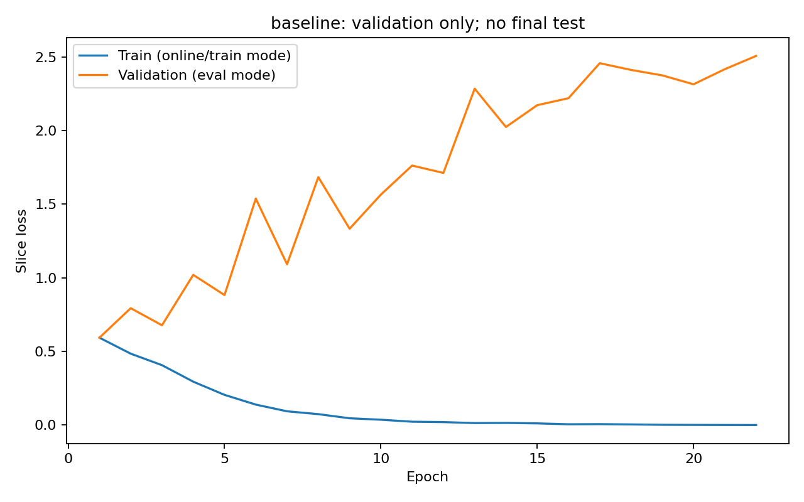
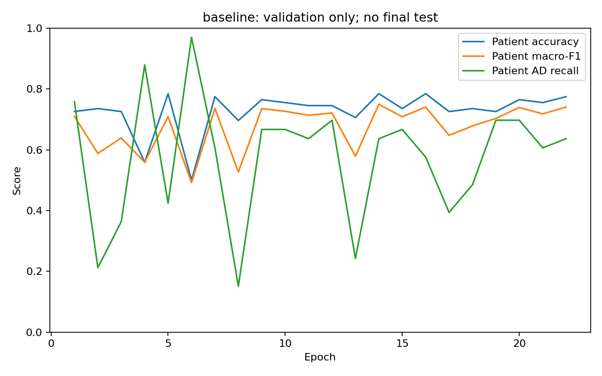
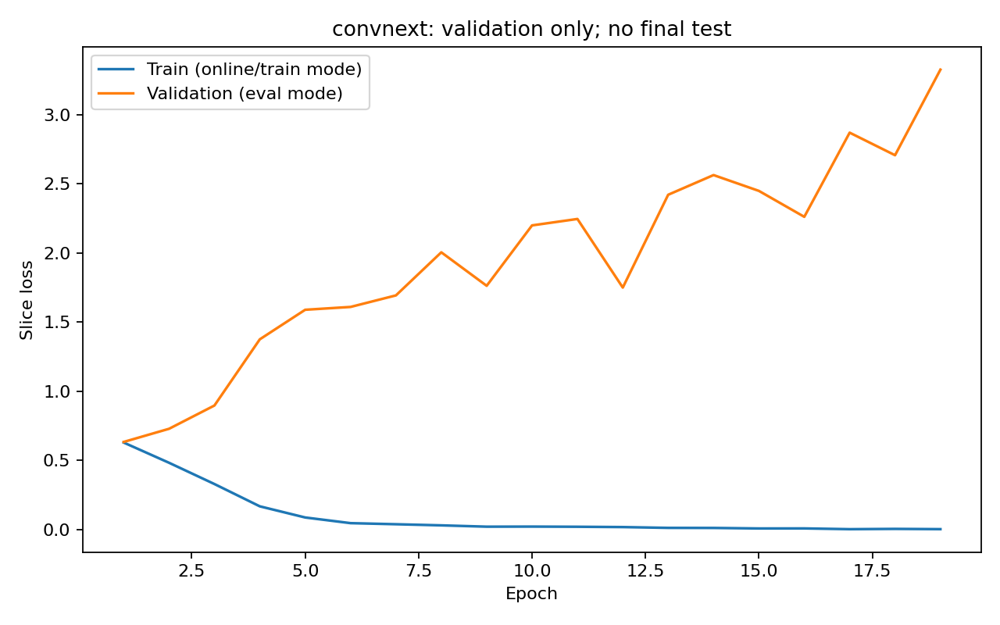
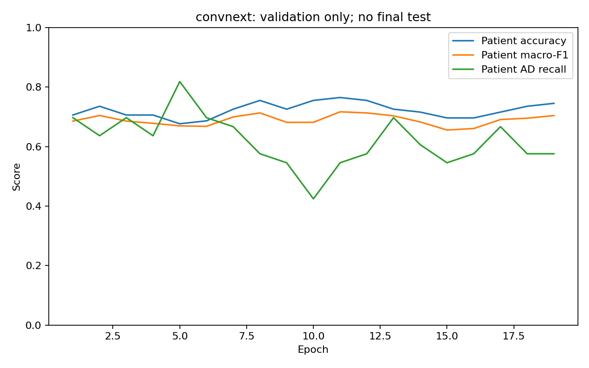
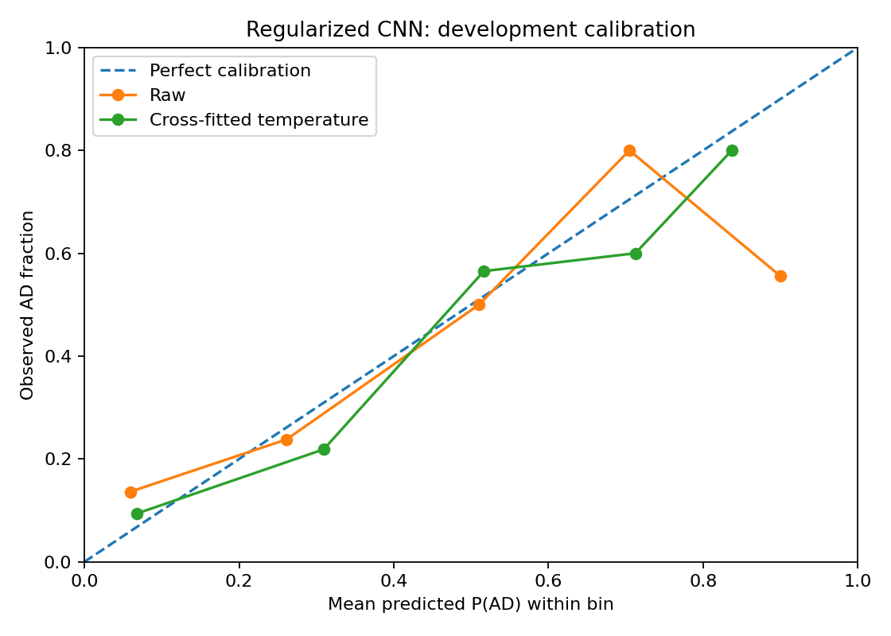
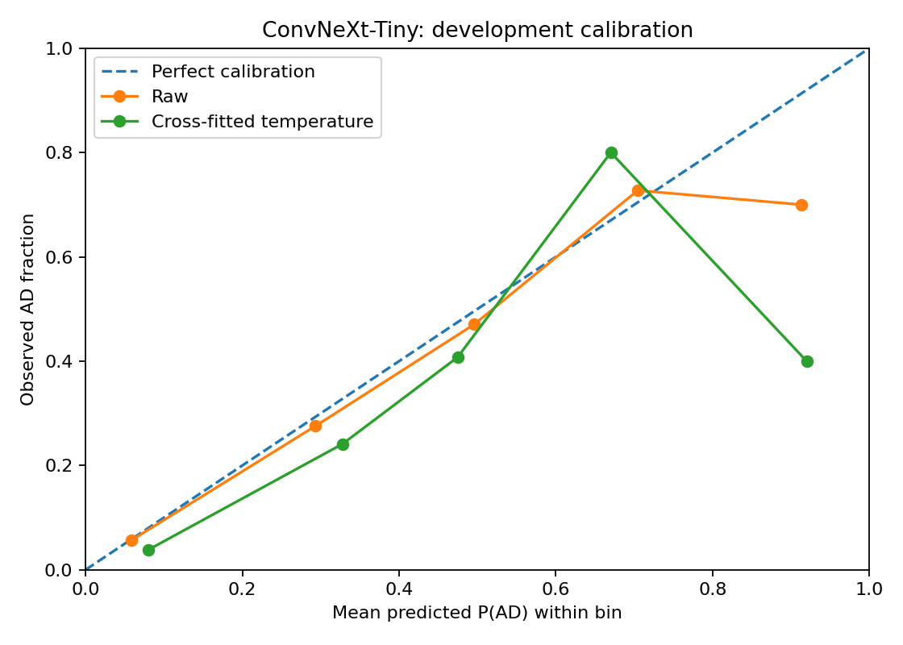
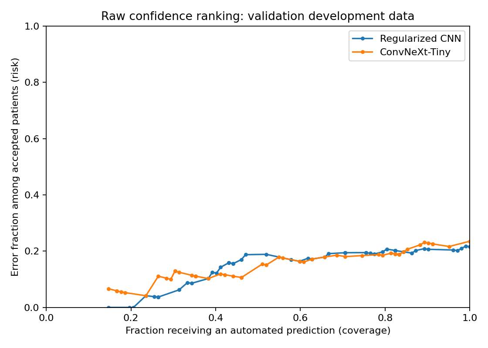
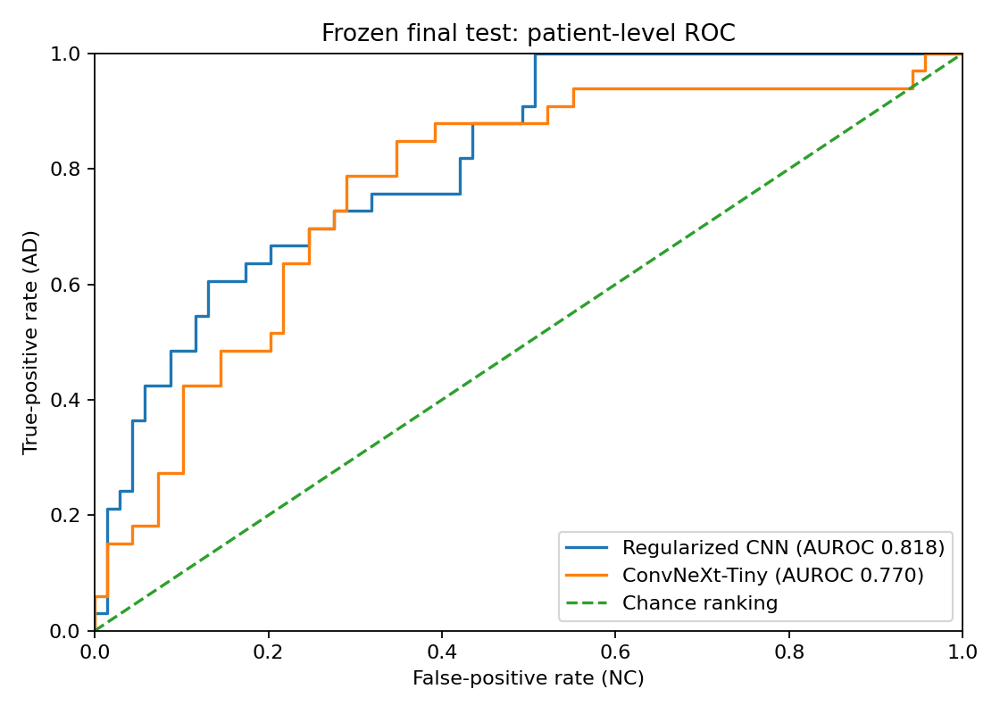
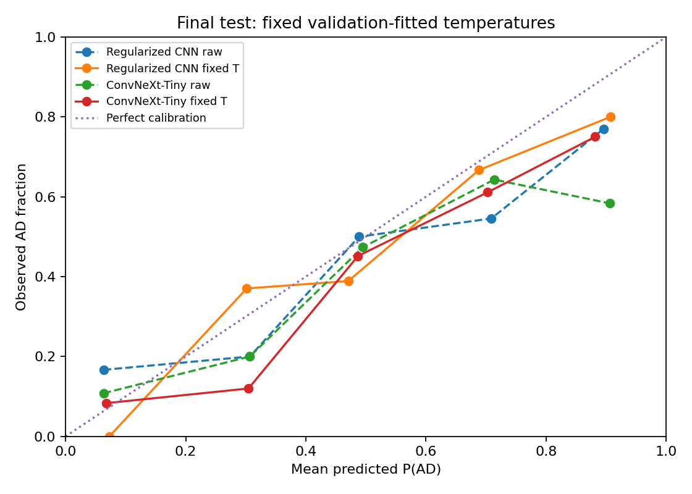

# Pattern Analysis

Pattern Analysis of various datasets by COMP3710 students in 2025 at the University of Queensland.



We create pattern recognition and image processing library for Tensorflow (TF), PyTorch or JAX.



This library is created and maintained by The University of Queensland [COMP3710](https://my.uq.edu.au/programs-courses/course.html?course_code=comp3710) students.



The library includes the following implemented in Tensorflow:

* fractals 

* recognition problems



In the recognition folder, you will find many recognition problems solved including:

* segmentation

* classification

* graph neural networks

* StyleGAN

* Stable diffusion

* transformers

etc.







<!-- COMP3710-STEP6-DATA-PIPELINE -->

## Data pipeline



The finalized patient-independent manifests, rather than the original directory names, determine the training, validation and test partitions. The CSV hashes and grouping consistency were verified before loading images. Model labels are NC = 0 and AD = 1; the original metadata codes 0 and 2 are retained as provenance.



| Partition | Patients | Scans | Images |

|---|---:|---:|---:|

| train | 476 | 1061 | 21220 |

| validation | 102 | 233 | 4660 |

| test | 102 | 232 | 4640 |



### Preprocessing and checks



Each supplied 256-by-240 greyscale JPEG is resized to 224-by-210 using bilinear interpolation and padded with seven black pixels above and below. No anatomy is cropped and the original aspect ratio is preserved. The result is one channel of 224-by-224 float32 values, scaled using (pixel / 255 - 0.5) / 0.5. This fixed scaling does not fit statistics to validation or test images. It does not recover physical MRI intensities from the supplied JPEGs.



The initial configuration uses no random augmentation. A small training-only rotation is implemented but disabled; enabling it later is a separate, documented experiment. Both the CNN baseline and ConvNeXt will use the same selected preprocessing.



A CPU-only pass successfully checked every final training and validation sample for shape, dtype, finite/range-correct values and exactly-once coverage, including the last partial batch. It did not train a network or decode the held-out test images. The test manifest was read only for split-integrity verification.



Subject and scan identifiers are retained privately in each batch for later hierarchical aggregation of probabilities; slice counts must not be confused with independent patient counts. Patient-level evaluation and confidence-based referral will be implemented with the training/evaluation stages.



A private before/after preview was generated for separate visual inspection. A local-byte versus Rangpur-source hash comparison was not performed. Model training, GPU memory and runtime measurements remain outstanding.



### Artificial Intelligence Usage Disclosure — update



ChatGPT assisted with drafting the data loader, verification script and synthetic tests. The code was checked by automated synthetic tests and a local CPU loader pass. I will document my own code review, understanding, visual inspection and any changes; these are not implied by the automated pass.



Manual visual check (2026-10-22): I inspected the private before/after training preview and found no unintended orientation, cropping or stretching changes.





<!-- COMP3710-STEP7-BASELINE -->

## Initial CNN baseline experiment



A four-block convolutional classifier was trained from scratch as the simpler comparison for the forthcoming ConvNeXt model. It uses the unchanged one-channel, 224-by-224 data pipeline. The fixed model labels are NC = 0 and AD = 1.



### Predeclared training and model selection



Configuration: `{'batch_size': 32, 'epochs': 20, 'patience': 5, 'learning_rate': 0.001, 'weight_decay': 0.0001, 'seed': 42, 'num_workers': 0, 'gradient_clip_norm': 5.0, 'device': 'cuda'}`. Training uses ordinary unweighted slice-level cross-entropy and uniformly shuffled images; repeated scans therefore contribute more training examples. No class weighting, data augmentation, pretrained weights, learning-rate search, calibration or threshold tuning was used in this initial experiment.



Validation aggregation averages slice probabilities within each scan, then averages the scan probabilities within each patient. The probability threshold is 0.5. Checkpoint selection uses patient macro-F1, with lower patient log loss breaking exact ties; the earliest exact tie is retained. Early stopping uses the same rule. These validation results are selected development results, not an unbiased final-test estimate.



Completed epochs: **12**; selected epoch: **7**.



| Validation unit | N | Accuracy | Macro-F1 | AUROC |

|---|---:|---:|---:|---:|

| slice | 4660 | 0.6910 | 0.6747 | 0.7790 |

| scan | 233 | 0.7082 | 0.6867 | 0.8236 |

| patient | 102 | 0.7843 | 0.7292 | 0.8327 |



Patient AD recall: **0.5152**. Patient NC recall: **0.9130**.

Training-majority-class reference validation accuracy: **0.6765**.



### Resources and reproducibility



Learnable parameters: **359,922**. Hardware: `{'torch_version': '2.7.1+cu126', 'device': 'cuda', 'precision': 'float32; mixed precision and TF32 disabled', 'device_name': 'NVIDIA GeForce RTX 4080 Laptop GPU', 'total_device_memory_gib': 11.99365234375}`.

Training-loop wall time (all completed epochs, including validation/checkpoints/history): **555.47 seconds**.

GPU allocator peaks: `{'peak_allocated_gib': 0.1967020034790039, 'peak_reserved_gib': 0.29296875, 'note': 'PyTorch process allocator peaks, not total VRAM used by Windows/other processes.'}`.

Model-only batch-size-1 latency: `{'batch_size': 1, 'repeats': 50, 'warmup': 10, 'median_ms_per_slice': 0.8040000102482736, 'p95_ms_per_slice': 0.8248999947682023, 'scope': 'Forward pass only, tensor already on device; not patient/end-to-end latency.'}`. This excludes image decoding/preprocessing and is not a full-patient latency.



CSV hashes, source-code hashes, the exact configuration, per-epoch history and the selected checkpoint were retained. Checkpoints and patient-linked prediction files are private and are not committed to GitHub. The final test images have not been evaluated by this step.



### Limitations and next experiment



This is one initial seed/configuration. The small training-subset fitting check is a debugging test, not evidence of generalisation. Validation performance may be optimistic because it selected the checkpoint. The test comparison, confidence-based referral, failure analysis and comparison with ConvNeXt remain outstanding.



### AI assistance for this stage



ChatGPT assisted with the baseline architecture, training/evaluation code, synthetic tests and this report draft. The student must document the checks they personally performed and must not treat generated code or test results as a substitute for understanding the model.













<!-- COMP3710-STEP8-CONVNEXT -->

## Step 8: baseline regularized experiment



This model was trained from random initial weights on the unchanged patient-independent training partition. Preprocessing and validation aggregation match the initial CNN. No pretrained weights, image augmentation, calibration, decision-threshold search or final-test evaluation were performed. The operating threshold remains 0.5.



Configuration: `{'model': 'baseline', 'batch_size': 8, 'accumulation_steps': 4, 'epochs': 30, 'min_epochs': 12, 'patience': 8, 'learning_rate': 0.0003, 'min_learning_rate': 1e-06, 'warmup_epochs': 3, 'weight_decay': 0.05, 'gradient_clip_norm': 5.0, 'seed': 42, 'num_workers': 0, 'device': 'cuda', 'budget_seconds': 10800.0}`.



AdamW uses stronger weight decay on kernels/matrices, excluding biases and one-dimensional normalization/LayerScale parameters. Learning rate has linear warmup followed by cosine decay. Both Step 8 architectures use the same settings, including physical batch size and gradient accumulation. Accumulation does not make BatchNorm behave like a larger physical batch.



Checkpoint selection: validation patient macro-F1, then lower patient log loss, then earliest. These are selected development results, not independent final-test estimates.



Completed epochs: 22; selected epoch: 14; stop reason: patience_after_minimum_epochs.



| Unit | N | Accuracy | Macro-F1 | AUROC | AD recall |

|---|---:|---:|---:|---:|---:|

| slice | 4660 | 0.6833 | 0.6724 | 0.7440 | 0.5670 |

| scan | 233 | 0.7382 | 0.7276 | 0.8069 | 0.6117 |

| patient | 102 | 0.7843 | 0.7496 | 0.8037 | 0.6364 |



Parameters: 359,922. Hardware: `{'torch_version': '2.7.1+cu126', 'device': 'cuda', 'precision': 'float32; mixed precision and TF32 disabled', 'device_name': 'NVIDIA GeForce RTX 4080 Laptop GPU', 'total_device_memory_gib': 11.99365234375}`.

Training loop time: 1609.03 seconds. GPU allocator peaks: `{'peak_allocated_gib': 0.11696767807006836, 'peak_reserved_gib': 0.166015625, 'note': 'PyTorch process allocator peaks, not total VRAM used by Windows/other processes.'}`.

Batch-1 model-only latency: `{'batch_size': 1, 'repeats': 50, 'warmup': 10, 'median_ms_per_slice': 0.8052500197663903, 'p95_ms_per_slice': 0.8132000220939517, 'scope': 'Forward pass only, tensor already on device; not patient/end-to-end latency.'}`. This excludes JPEG loading, preprocessing and patient aggregation.



Limitations: one seed per configuration, repeated use of the development validation set, slice-weighted training (patients with more scans contribute more examples), and no clinical validation. The two Step 8 runs share a recipe, but it is not claimed to be optimal for both architectures. The Step 7-to-Step 8 change is a multi-setting intervention, not an isolated causal test of weight decay. Data remain restricted; private predictions/checkpoints are not committed. Confidence referral and final held-out comparison remain outstanding.



AI disclosure: ChatGPT assisted with implementation, tests and this draft. Record the actual source review and local checks performed; do not claim unperformed checks.



## Step 8: convnext regularized experiment



This model was trained from random initial weights on the unchanged patient-independent training partition. Preprocessing and validation aggregation match the initial CNN. No pretrained weights, image augmentation, calibration, decision-threshold search or final-test evaluation were performed. The operating threshold remains 0.5.



Configuration: `{'model': 'convnext', 'batch_size': 8, 'accumulation_steps': 4, 'epochs': 30, 'min_epochs': 12, 'patience': 8, 'learning_rate': 0.0003, 'min_learning_rate': 1e-06, 'warmup_epochs': 3, 'weight_decay': 0.05, 'gradient_clip_norm': 5.0, 'seed': 42, 'num_workers': 0, 'device': 'cuda', 'budget_seconds': 10800.0}`.



AdamW uses stronger weight decay on kernels/matrices, excluding biases and one-dimensional normalization/LayerScale parameters. Learning rate has linear warmup followed by cosine decay. Both Step 8 architectures use the same settings, including physical batch size and gradient accumulation. Accumulation does not make BatchNorm behave like a larger physical batch.



Checkpoint selection: validation patient macro-F1, then lower patient log loss, then earliest. These are selected development results, not independent final-test estimates.



Completed epochs: 19; selected epoch: 11; stop reason: patience_after_minimum_epochs.



| Unit | N | Accuracy | Macro-F1 | AUROC | AD recall |

|---|---:|---:|---:|---:|---:|

| slice | 4660 | 0.6601 | 0.6508 | 0.7205 | 0.5621 |

| scan | 233 | 0.6953 | 0.6829 | 0.7879 | 0.5631 |

| patient | 102 | 0.7647 | 0.7167 | 0.8006 | 0.5455 |



Parameters: 27,818,594. Hardware: `{'torch_version': '2.7.1+cu126', 'device': 'cuda', 'precision': 'float32; mixed precision and TF32 disabled', 'device_name': 'NVIDIA GeForce RTX 4080 Laptop GPU', 'total_device_memory_gib': 11.99365234375}`.

Training loop time: 5262.38 seconds. GPU allocator peaks: `{'peak_allocated_gib': 1.3108057975769043, 'peak_reserved_gib': 1.392578125, 'note': 'PyTorch process allocator peaks, not total VRAM used by Windows/other processes.'}`.

Batch-1 model-only latency: `{'batch_size': 1, 'repeats': 50, 'warmup': 10, 'median_ms_per_slice': 9.246149999853515, 'p95_ms_per_slice': 14.084000000366359, 'scope': 'Forward pass only, tensor already on device; not patient/end-to-end latency.'}`. This excludes JPEG loading, preprocessing and patient aggregation.



Limitations: one seed per configuration, repeated use of the development validation set, slice-weighted training (patients with more scans contribute more examples), and no clinical validation. The two Step 8 runs share a recipe, but it is not claimed to be optimal for both architectures. The Step 7-to-Step 8 change is a multi-setting intervention, not an isolated causal test of weight decay. Data remain restricted; private predictions/checkpoints are not committed. Confidence referral and final held-out comparison remain outstanding.



AI disclosure: ChatGPT assisted with implementation, tests and this draft. Record the actual source review and local checks performed; do not claim unperformed checks.



## Step 8: validation comparison



The original CNN experiment was retained. One more strongly regularized CNN and one ConvNeXt-Tiny were trained from scratch using a shared, predeclared Step 8 recipe. The data splits, image preprocessing, validation aggregation, selection criterion and 0.5 decision threshold were unchanged. Final-test images were not evaluated.



| Model | Patient accuracy | Macro-F1 | AUROC | AD recall | NC recall | Selected epoch |

|---|---:|---:|---:|---:|---:|---:|

| Initial CNN | 78.43% | 0.7292 | 0.8327 | 51.52% | 91.30% | 7 |

| Regularized CNN | 78.43% | 0.7496 | 0.8037 | 63.64% | 85.51% | 14 |

| ConvNeXt-Tiny | 76.47% | 0.7167 | 0.8006 | 54.55% | 86.96% | 11 |



Preferred CNN under the predefined validation selection rule: **Regularized CNN**. Retain both CNN runs and report this selection; do not select a weaker baseline to favour ConvNeXt.



The initial-to-regularized CNN comparison changes multiple training settings at once; it does not isolate weight decay. The Step 8 CNN and ConvNeXt have matched optimizer settings and batch configuration, but their architectures and intrinsic regularizers differ. One seed, repeated validation use and a small validation cohort limit generalisation claims. Check stop reasons for any time-limited runs. No result here demonstrates attainment of the final-test accuracy target. Confidence calibration, referral analysis and the final test remain outstanding.



### Implementation and verification



ConvNeXt-Tiny uses stage depths (3,3,9,3), widths (96,192,384,768), a one-channel stem, depthwise 7x7 convolutions, channel LayerNorm, 4x inverted bottlenecks, GELU, LayerScale and stochastic depth. It was implemented in PyTorch without downloading pretrained weights. Reference: Liu et al., *A ConvNet for the 2020s*, CVPR 2022, https://arxiv.org/abs/2201.03545 (assessment reference [7]).



ChatGPT assisted with code, tests and this draft. Record the checks and code review actually performed in the report's Artificial Intelligence Usage Disclosure.



















<!-- COMP3710-STEP9-CONFIDENCE -->
## Step 9: confidence calibration and referral analysis

Development evidence only. The checkpoints were already selected using these validation patients. Cross-fitting only separates fitting of the temperature and referral rule from their diagnostic evaluation; it does not make the underlying model-selection process independent. Empirical referral constraints are not clinically validated safety guarantees. Final-test performance is unknown.

No further neural-network training or inference was performed. Saved validation predictions were checked against their original metrics, finalized manifests and selected checkpoint hashes. The patient probability is the mean of scan means of slice P(AD). No final-test images or predictions were used.

The preferred CNN from the existing validation comparison was retained; it was not switched according to these new confidence results. Temperature scaling acts on clipped patient log-odds with T in [0.5,10]. The diagnostic class cutoff remains 0.5. A single temperature cannot change these class decisions or improve confidence ordering, apart from numerical clipping/ties. It does not make an inaccurate model accurate.

### Probability calibration

NLL and Brier score should be lower for better probability quality. Five-bin AD-probability ECE is bin-sensitive and imprecise for this small cohort. The full-validation fit is an in-sample calibration result, not an unbiased improvement estimate. Five-fold cross-fitting holds each patient's labels out of temperature and cutoff fitting only; checkpoint selection had already used the complete validation cohort.

| Model | Raw NLL | Full-fit NLL | Cross-fit NLL | Raw Brier | Cross-fit Brier | T (full fit) |
|---|---:|---:|---:|---:|---:|---:|
| Regularized CNN | 0.5205 | 0.4955 | 0.5012 | 0.1715 | 0.1692 | 1.6134 |
| ConvNeXt-Tiny | 0.5515 | 0.5251 | 0.5382 | 0.1709 | 0.1746 | 1.7049 |

### Does confidence identify mistakes?

Error-detection AUROC uses wrong prediction as the positive class and 1-confidence as its score. A value of 0.5 is chance ranking; it is different from AD classification AUROC.

| Model | Wrong patients | Mean confidence: correct | Mean confidence: wrong | Errors at confidence >=0.90 | Error-detection AUROC |
|---|---:|---:|---:|---:|---:|
| Regularized CNN | 22 | 0.8188 | 0.7511 | 4 | 0.6398 |
| ConvNeXt-Tiny | 24 | 0.8012 | 0.7036 | 4 | 0.6795 |

### Proposed referral policy

Accept the 0.5-threshold class prediction only when calibrated max(P(AD),1-P(AD)) >= tau; otherwise refer for review. From the predefined finite grid, select maximum development coverage subject to at least max(20,ceil(25% of fit patients)) accepted, <=10% observed error among accepted patients, and <=10% of all AD patients incorrectly auto-cleared as NC. Break coverage ties by the smaller cutoff. These are exploratory engineering constraints, NOT clinical safety standards. If no cutoff qualifies, the rule refers everyone.

| Model | Full-fit tau | Full-fit coverage | Full-fit accepted error | Cross-fit coverage | Cross-fit accepted error | Cross-fit AD auto-cleared / all AD |
|---|---:|---:|---:|---:|---:|---:|
| Regularized CNN | 0.850 | 26.47% | 3.70% | 26.47% | 14.81% | 3/33 |
| ConvNeXt-Tiny | Refer all | 0.00% | Not estimable | 21.57% | 13.64% | 1/33 |

Referred cases are not counted as correct diagnoses. 'AD not automatically cleared' is a routing measure, not diagnostic sensitivity or an assumption of perfect human review. Accuracy within an accepted subset is NOT all-patient test accuracy and does not demonstrate the assessment's 0.80 target. Descriptive Wilson intervals are in the JSON summary; they do not account for selection or cross-fit dependence.

### Status and next decision

The full-validation temperatures and referral rules are saved for a subsequent, explicitly frozen evaluation plan. The final test has NOT been run. These diagnostics must be reviewed before any claim of an operational benefit or any final evaluation. No new training run was chosen automatically on the basis of these results.

### Assistance and reproducibility

ChatGPT assisted with implementation, synthetic tests and this generated report draft. Document the review and local checks actually performed in the Artificial Intelligence Usage Disclosure; do not claim clinical validation. Package/source hashes and input hashes are recorded in the aggregate summary. Method reference: Guo et al., On Calibration of Modern Neural Networks, ICML 2017, https://arxiv.org/abs/1706.04599 .







<!-- COMP3710-STEP10-FINAL-TEST -->
## Step 10: frozen final-test evaluation

Research prototype, not a clinical diagnostic system. One development/test split and one training seed do not establish clinical validity or generalisation to other sites. The held-out test is now exposed: do not tune, refit temperatures, change referral cutoffs, swap checkpoints, or change the patient split using these results.

The preferred CNN and ConvNeXt checkpoints, temperatures and referral rules were fixed using development evidence and committed before test inference. No checkpoint selection, training, temperature fitting or cutoff search used this test set. The primary unit is a patient; scan and slice results are secondary. Patient probabilities are means of scan means of slice P(AD).

| Model | Patient accuracy | Macro-F1 | AUROC | AD recall | NC recall |
|---|---:|---:|---:|---:|---:|
| Regularized CNN | 77.45% | 0.7258 | 0.8177 | 54.55% | 88.41% |
| ConvNeXt-Tiny | 72.55% | 0.6912 | 0.7703 | 60.61% | 78.26% |

Regularized CNN: 79/102 patients correct; descriptive 95% Wilson accuracy interval 68.43%–84.48%.

ConvNeXt-Tiny: 74/102 patients correct; descriptive 95% Wilson accuracy interval 63.19%–80.27%.

### Secondary evaluation units

| Model | Scan accuracy | Slice accuracy |
|---|---:|---:|
| Regularized CNN | 72.41% | 68.81% |
| ConvNeXt-Tiny | 69.40% | 65.95% |

**ConvNeXt all-patient 0.80 target: NOT met on this test split.** This is a measured result, not a guarantee of marks or clinical performance. Accepted-subset accuracy is not a substitute.

### Frozen referral and calibration

| Model | Coverage | Accepted error | Referred | AD auto-cleared as NC / all AD |
|---|---:|---:|---:|---:|
| Regularized CNN | 31.37% | 3.12% | 70/102 | 0/33 |
| ConvNeXt-Tiny | 0.00% | Not estimable | 102/102 | 0/33 |

Refer-all means no automation benefit and no estimable accepted accuracy; it is not perfect performance. Referred patients are not counted as correctly diagnosed. No human-review accuracy is assumed. Temperature scaling does not change 0.5-threshold class decisions. The policies are research-only; passing an empirical fraction is not clinical validation.

| Model | Raw NLL | Fixed-T NLL | Raw Brier | Fixed-T Brier |
|---|---:|---:|---:|---:|
| Regularized CNN | 0.5138 | 0.4839 | 0.1655 | 0.1607 |
| ConvNeXt-Tiny | 0.7104 | 0.6175 | 0.1877 | 0.1863 |

Paired ConvNeXt minus CNN accuracy: -4.90%; exploratory patient-bootstrap 95% percentile interval -13.73%–3.92%. This interval does not incorporate training-seed or cross-site variation.

### Reproducibility and resources

Checkpoint/source/manifest/plan hashes are recorded in the JSON report. Test inference used float32, batch size 8 and no augmentation. The earlier training-memory/runtime and batch-1 latency measurements remain in the report. Additional measured test-batch times exclude result-file writing and resume verification; GPU allocator peaks are not total Windows VRAM use.

### Failure analysis — manual work outstanding

5 distinct cases were selected using the frozen rule. The private worksheet and three-slice panels support manual review. Generating those files is NOT a completed failure autopsy. Add 3–5 evidence-based case analyses and a final engineering recommendation after reviewing them. Do not publish patient identifiers or medical images without the applicable authorisation.

### AI assistance

ChatGPT assisted with code, synthetic tests and this generated draft. Record the code review, local tests and manual failure analysis actually performed; do not claim independent clinical verification.

<!-- COMP3710-A1-STABILITY -->
## A1 replication stability check

**Development results only. No final-test inference or threshold fitting was performed.**

The existing seed-42 A1 recipe was repeated at the predeclared seeds 43 and 44. Only the random seed changed. This changes initialization, stochastic layers, augmentation draws and training order, not just initialization. Each run selected its checkpoint by validation patient accuracy, then macro-F1, then lower log loss; the earliest exact tie was retained.

| Seed | Selected epoch / completed | Correct patients | Accuracy | Macro-F1 | AUROC | AD recall | NC recall | Epochs ≥80% |
|---|---:|---:|---:|---:|---:|---:|---:|---:|
| 42 | 13 / 21 | 85/102 | 83.33% | 0.8012 | 0.8331 | 66.67% | 91.30% | 1 |
| 43 | 8 / 16 | 80/102 | 78.43% | 0.7496 | 0.7980 | 63.64% | 85.51% | 0 |
| 44 | 7 / 15 | 80/102 | 78.43% | 0.7574 | 0.8169 | 69.70% | 82.61% | 0 |

| Cohort of runs | Mean accuracy | Sample SD (percentage points) | Accuracy range |
|---|---:|---:|---:|
| All three (includes recipe-selection seed 42) | 80.07% | 2.83 | 78.43%–83.33% |
| New replications only (43 and 44) | 78.43% | 0.00 | 78.43%–78.43% |

These are repeated measurements on the same patients, not a larger independent test cohort. Selected-checkpoint means and sample standard deviations are descriptive; they do not establish an 80% test result.

Seed 42 remains the provisional candidate. No seed has been automatically substituted, no models have been ensembled, and no calibration or referral rule has been transferred from Version 1. The results require review before another model-development decision or revised evaluation.

Existing A1/A2 histories and private checkpoints were preserved. Resumption repeats only work after the last usable completed-epoch checkpoint. Runtime excludes interrupted partial work and checkpoint/report I/O.

ChatGPT assisted with this additive runner, tests and draft. Document the code review and checks actually performed in the Artificial Intelligence Usage Disclosure; do not claim clinical verification.
